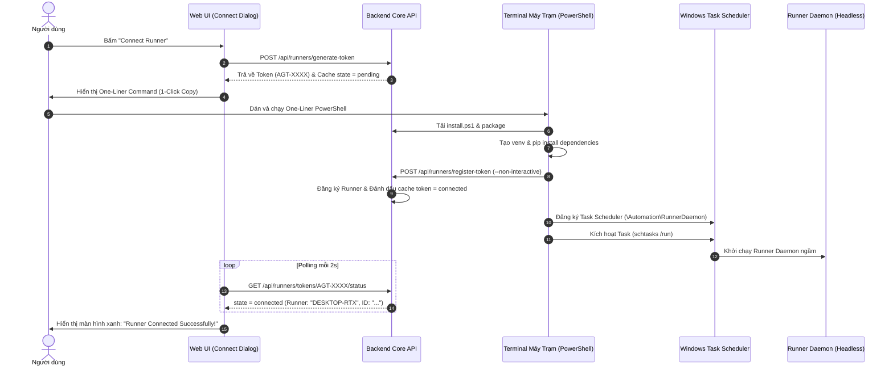

# Kế Hoạch Kỹ Thuật: Chuẩn Hóa Cài Đặt One-Liner Dòng Lệnh & Quản Lý Tiến Trình Daemon Runner (Phương Án B - Parameterized)

> **Mã kế hoạch:** `PLAN-2026-10-10-RUNNER-DAEMON-ONELINER`  
> **Trạng thái:** Đã phê duyệt phương án (Approved - In Progress)  
> **Thời gian cập nhật:** 10/10/2026  
> **Phạm vi tác động:**  
> - `workers/`: Python Worker Core CLI, Non-interactive Registration, Windows Task Scheduler Daemon Manager, PID tracking, Log rotation.  
> - `api/`: Backend Bootstrap Scripts Endpoints (`install.ps1`, `install.sh`), Token Handshake Status Polling (`/api/runners/tokens/{token}/status`).  
> - `web/`: `ConnectRunnerDialog.tsx`, Live Pairing Status Polling Hook (`useTokenStatusPolling`).  
> - `.agents/playbooks/`: Cập nhật `worker-runtime.md`.  

---

## 1. Tóm Tắt Quyết Định Kỹ Thuật (Architecture Decisions)

1. **Phương án B - Tham số hóa Định danh Ứng dụng (Parameterized App Identifier)**:
   - Sử dụng định danh chuẩn hóa:
     - `APP_SLUG = "automation"`
     - `APP_NAME = "Automation Studio"`
     - `CLI_PROG = "runner"`
   - Toàn bộ đường dẫn thư mục cài đặt, tên Task Scheduler, file cấu hình, One-Liner template đều sinh ra từ các biến này. Sau này khi chốt tên thương hiệu chính thức, chỉ cần thay đổi 1 dòng khai báo duy nhất.
2. **Quản lý Tiến trình Daemon trên Windows (Task Scheduler - On Logon)**:
   - **Loại bỏ hoàn toàn `pystray`** (không dùng GUI System Tray).
   - Sử dụng **Windows Task Scheduler** (`schtasks.exe`):
     - Tên Task: `\Automation\RunnerDaemon`
     - Trigger: `At logon` (`/SC ONLOGON /RU %USERNAME%`) -> Hoạt động tự động trong phiên đăng nhập của người dùng.
     - Chạy ẩn hoàn toàn không hiện cửa sổ console (thông qua `pythonw.exe` hoặc silent launcher script).
     - **Ưu điểm quyết định:** Bảo đảm Blender và Unreal Engine có 100% quyền truy cập driver GPU (NVIDIA/AMD) và VRAM, tránh triệt để lỗi mất GPU do **Session 0 Isolation** của Windows Service cổ điển.
3. **Cơ chế Nhận diện Kết nối Thành công Thời gian Thực (Real-Time Pairing Handshake)**:
   - Khi tạo token: Lưu trạng thái `pending` vào cache kèm metadata (TTL 30 phút).
   - Khi Runner đăng ký qua One-Liner: API `register-token` xử lý xong sẽ ghi nhận trạng thái `connected` vào cache key `runner_token_status:{token}` kèm thông tin máy trạm (Runner ID, Name, MachineKey) trong 10 phút.
   - API mới: `GET /api/runners/tokens/{token}/status` cho phép Web UI kiểm tra trạng thái token.
   - Giao diện `ConnectRunnerDialog` poll mỗi 2 giây: Ngay khi máy trạm hoàn thành cài đặt và đăng ký, modal lập tức chuyển sang màn hình xanh thông báo thành công (Live Connected Card), hiển thị tên máy và cấu hình.
4. **Cài Đặt Nhanh 1 Lần (One-Liner Bootstrap)**:
   - Một dòng lệnh duy nhất cho PowerShell (Windows) và Bash (Linux/macOS).
   - Tự động: Kiểm tra Python -> Tạo virtualenv -> Cài thư viện -> Đăng ký non-interactive -> Cài đặt Task Scheduler/Service -> Khởi động daemon.

---

## 2. Kiến Trúc Luồng Hoạt Động (Data & Interaction Lifecycle)



---

## 3. Chi Tiết Kế Hoạch Triển Khai Theo 4 Giai Đoạn (Implementation Slices)

### Giai Đoạn 1: Cải Tiến Python Worker Core & Daemon CLI (`workers/`)
- [ ] **1.1. Non-interactive `runner register`**:
  - File: [workers/commands/register.py](file:///d:/FullStack/Automation/workers/commands/register.py) & [workers/cli.py](file:///d:/FullStack/Automation/workers/cli.py)
  - Hỗ trợ các tham số: `--url`, `--token`, `--name`, `--non-interactive`.
  - Nếu truyền đủ tham số, tự động thực hiện từ đầu đến cuối không dừng lại hỏi `input()`.
- [ ] **1.2. Module `workers/core/daemon/`**:
  - `base.py`: Lớp trừu tượng `BaseServiceManager` (install, uninstall, start, stop, restart, status, logs).
  - `windows_scheduler.py`:
    - Tạo task: `schtasks /create /tn "\Automation\RunnerDaemon" /tr "..." /sc onlogon /f /ru "%USERNAME%"`.
    - Điều khiển: `schtasks /run`, `schtasks /end`.
    - Trình khởi chạy ẩn: Sử dụng `pythonw.exe` hoặc script vbs/ps1 hidden để không hiện cửa sổ command prompt.
  - `pid_lock.py`: Quản lý PID file (`runner.pid`), chống chạy trùng lặp (single instance), hỗ trợ gửi signal graceful shutdown.
  - `service_manager.py`: Factory định tuyến theo hệ điều hành (Windows -> `WindowsSchedulerManager`, Linux -> `SystemdManager`, macOS -> `LaunchdManager`).
- [ ] **1.3. Lệnh CLI `runner service`**:
  - Bổ sung subparser `service` vào `cli.py`:
    - `runner service install [--autostart]`
    - `runner service uninstall`
    - `runner service start`
    - `runner service stop`
    - `runner service restart`
    - `runner service status`
    - `runner service logs [-n <lines>] [-f]`
- [ ] **1.4. Quản lý Log Rotation tập trung**:
  - Cấu hình `RotatingFileHandler` ghi log vào `workers/logs/runner.log` (20MB x 5 backups).

### Giai Đoạn 2: Xây Dựng Backend Handshake & Bootstrap API (`api/`)
- [ ] **2.1. Lưu trạng thái Token Claimed**:
  - File: [RegisterRunnerWithToken.cs](file:///d:/FullStack/Automation/api/src/Modules/Runner/Automation.Runner/Features/Runners/RegisterRunnerWithToken.cs)
  - Sau khi đăng ký Runner thành công, lưu thông tin vào cache:
    `runner_token_status:{token}` -> `{ Status: "connected", RunnerId: id, RunnerName: name, MachineKey: key, ConnectedAt: DateTimeOffset.UtcNow }` với TTL 10 phút.
- [ ] **2.2. Endpoint kiểm tra trạng thái Token (`GetSetupTokenStatus.cs`)**:
  - Route: `GET /api/runners/tokens/{token}/status`
  - AllowAnonymous (hoặc yêu cầu quyền cơ bản).
  - Trả về DTO: `{ status: "pending" | "connected" | "expired", runnerId?: Guid, runnerName?: string, machineKey?: string }`.
- [ ] **2.3. Endpoint phục vụ One-Liner Script (`GetBootstrapScript.cs`)**:
  - Route: `GET /api/runners/bootstrap/install.ps1` (Windows) & `GET /api/runners/bootstrap/install.sh` (Linux/macOS).
  - Đọc nội dung file template script, thế các biến tham số (`$APP_NAME`, `$APP_SLUG`, `$DEFAULT_URL`) và trả về text/plain.
- [ ] **2.4. Template Script Bootstrap**:
  - Tạo `workers/scripts/install.ps1` (PowerShell) và `workers/scripts/install.sh` (Bash).
  - Script nhận tham số `-Url` và `-Token`, tự động thực hiện toàn bộ các bước:
    `Kiểm tra Python` -> `Tạo .venv` -> `pip install` -> `runner register` -> `runner service install` -> `runner service start`.

### Giai Đoạn 3: Nâng Cấp Giao Diện Web UI (`web/`)
- [ ] **3.1. Hook `useTokenStatusPolling`**:
  - Viết custom hook trong `web/src/features/runners/hooks/useTokenStatusPolling.ts`.
  - Sử dụng TanStack Query với `refetchInterval: 2000` khi dialog mở và có token.
  - Tự động dừng polling khi token đạt trạng thái `connected` hoặc `expired`.
- [ ] **3.2. Cải tiến `ConnectRunnerDialog.tsx`**:
  - File: [ConnectRunnerDialog.tsx](file:///d:/FullStack/Automation/web/src/features/runners/dialogs/ConnectRunnerDialog.tsx)
  - **Tabs chọn hệ điều hành**: Windows (PowerShell) | Linux (Bash) | macOS (Zsh).
  - **Khối lệnh Hero One-Liner**:
    ```powershell
    & ([scriptblock]::Create((irm "http://localhost:5189/api/runners/bootstrap/install.ps1"))) -Url "http://localhost:5189/api" -Token "AGT-xxxx"
    ```
    Nút Copy 1-Click lớn, nổi bật.
  - **Màn hình Real-Time Connected Card**:
    - Khi hook báo `connected`:
      - Ẩn khối lệnh, hiển thị Banner xanh rực rỡ với icon Checkmark lớn.
      - Hiển thị thông số máy trạm: Tên máy, ID, trạng thái Online.
      - Nút "Done" để đóng modal và tự động invalidate query danh sách Runners để cập nhật bảng/card ngay lập tức.
  - **Section tham khảo câu lệnh**: Bổ sung hướng dẫn ngắn gọn các lệnh `runner service status`, `runner service stop`, `runner service logs`.

### Giai Đoạn 4: Kiểm Thử & Xác Minh Hoàn Thiện
- [ ] **4.1. Kiểm thử Non-interactive Registration & Task Scheduler**:
  - Chạy thử lệnh `runner register --token ... --url ... --non-interactive`.
  - Chạy thử `runner service install`, kiểm tra Task Scheduler trong Windows (`schtasks /query /tn "\Automation\RunnerDaemon"`).
  - Chạy `runner service start`, kiểm tra process daemon sống trong Task Manager dưới user hiện tại.
  - Kiểm tra `runner service status` và `runner service logs`.
- [ ] **4.2. Kiểm thử Handshake Web UI**:
  - Mở Dialog trên trình duyệt -> copy One-Liner -> chạy trong PowerShell -> quan sát Web UI tự động chuyển sang trạng thái "Connected" sau vài giây mà không cần bấm reload.
- [ ] **4.3. Cập nhật Playbook**:
  - Cập nhật [.agents/playbooks/worker-runtime.md](file:///d:/FullStack/Automation/.agents/playbooks/worker-runtime.md) với kiến trúc Task Scheduler và One-Liner mới.
