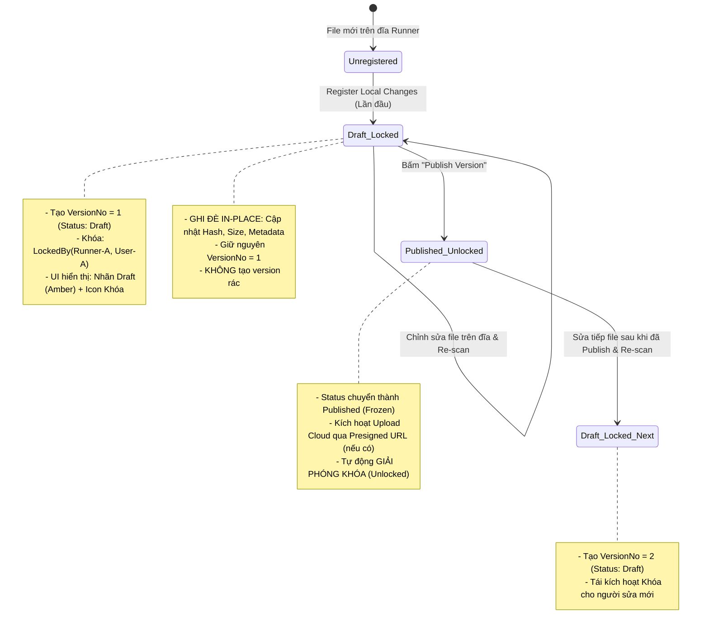
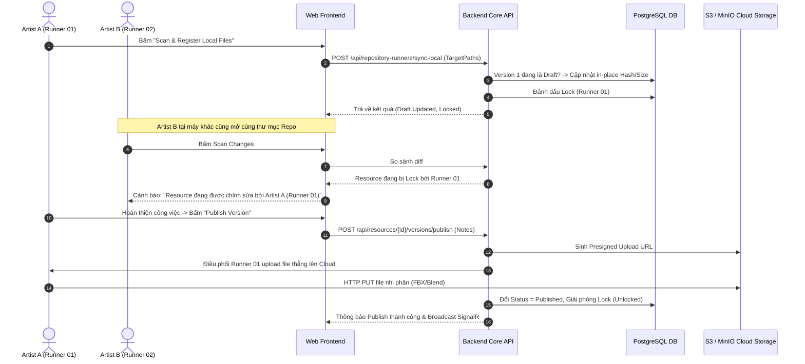

# Kế Hoạch Kỹ Thuật: Tái Cấu Trúc Vòng Đời Resource (Draft / Publish), Cơ Chế Smart Collaborative Lock & Tầng Lưu Trữ Studio Storage

> **Mã kế hoạch:** `PLAN-2026-10-11-RESOURCE-LIFECYCLE-LOCK-STUDIO-STORAGE`  
> **Trạng thái:** Bản thảo đề xuất chi tiết (Draft Proposal - Chờ phản hồi chọn Phase)  
> **Thời gian cập nhật:** 11/10/2026  
> **Phạm vi tác động:**  
> - `api/`: Module `Automation.Repository` (Entities, Handlers, Endpoints, Migration), Module `Automation.Pipeline` (Event Bridge, Tools), Module `Automation.Files` / `Studio` (Storage Profile).  
> - `web/`: `features/repositories/` (RepositorySyncTab, ResourceDetailPage, LocalChangesTable, ResourceVersionsTable), API Generated Hooks.  
> - `workers/`: Background Upload Daemon Command (gRPC Presigned URL Upload - Phase 3).  
> - `.agents/playbooks/`: Cập nhật `resource-repository-lifecycle.md`.

---

## 1. Tóm Tắt Bối Cảnh & Quyết Định Kỹ Thuật (Architecture Decisions)

### 1.1. Bối cảnh & Vấn đề Cốt lõi
1. **Hiểu nhầm về lưu trữ dữ liệu (False Sense of Persistence):**
   - Hiện tại UI dùng icon đám mây (`UploadCloud`) với nhãn *"Synchronize to Repository"* kèm ô *"Commit note"*, khiến Artist hiểu nhầm file đã được tải lên Cloud an toàn. Thực chất **không có byte file nào được đẩy lên Cloud**, hệ thống chỉ quét đĩa local và đăng ký chỉ mục (Index) vào PostgreSQL.
2. **Bùng nổ phiên bản rác (Version Explosion):**
   - Artist 3D chỉnh sửa file liên tục (tweak texture, chỉnh xương, sửa vật liệu). Cứ mỗi lần thay đổi hash file mà bấm "Sync" lại sinh ra `v2, v3, v4...` vô tội vạ dù vẫn đang trong giai đoạn làm nháp.
3. **Hiểm họa xung đột tệp nhị phân 3D (Unmergeable Binary File Conflicts):**
   - File 3D (`.blend`, `.fbx`, `.uasset`, `.psd`) không thể merge như code Git. Nếu 2 Artist cùng mở file trên 2 máy Runner khác nhau, người đăng ký sau sẽ đè bẹp công sức người trước mà không hề có cảnh báo.
4. **Cấu hình lưu trữ phân mảnh:**
   - Việc cấu hình storage rải rác từng Repository gây lặp lại. Cần đưa cấu hình lưu trữ lên cấp Studio/Project (Studio Storage Profile).

---

### 1.2. Các Quyết Định Kiến Trúc Cốt Lõi

1. **Tách biệt Vòng đời: "Local Register (Draft)" vs "Publish (Frozen/Cloud)"**:
   - **Local Register / Scan**: Chỉ đóng vai trò nhận diện tệp cục bộ vào DB (`Status = Draft`). Mọi lần quét cập nhật tiếp theo khi hash thay đổi sẽ **ghi đè in-place** trên cùng một `VersionNo` đang là Draft, tuyệt đối **không tăng số phiên bản**.
   - **Publish Version**: Đóng băng phiên bản (`Status = Published`), kích hoạt đóng gói/đồng bộ Cloud (nếu bật), sinh `VersionNo` mới cho lần chỉnh sửa tiếp theo.
2. **Cơ chế Smart Collaborative Lock (Khóa cộng tác thông minh)**:
   - Học tập triết lý từ Perforce Helix Core và Anchorpoint nhưng theo hướng thanh thoát, hiện đại:
   - Khi Runner A đăng ký tệp lần đầu hoặc đang sửa Draft, Resource được gắn `LockedByRunnerId`, `LockedByUserId`, `LockedAt`.
   - UI hiển thị nhãn/avatar trực quan: 🔒 *"Being edited by Cong on Runner-01"*.
   - Runner khác quét thấy tệp này sẽ bị chặn Register đè lên (Pessimistic Warning), trừ khi được chuyển giao hoặc Admin thực hiện *Force Unlock*.
   - Khi bấm **Publish Version** $\rightarrow$ Hệ thống tự động giải phóng khóa (Auto Unlock).
3. **Tầng Lưu trữ Cấp Studio (Studio Storage Profile & BYOS)**:
   - Đưa định nghĩa Storage Profile lên cấp Studio/Project (hỗ trợ `LocalOnly`, `S3Compatible / MinIO`, `Studio NAS SMB`).
   - Tối ưu tải tệp nặng: Runner tải file trực tiếp lên Cloud qua **Presigned Upload URL** (HTTP PUT), hoàn toàn không đẩy qua .NET API Server để tránh nghẽn RAM và băng thông.

---

## 2. Kiến Trúc Luồng Hoạt Động (Data & Interaction Lifecycle)

### 2.1. Vòng đời Draft $\rightarrow$ Publish & Lock State Machine



---

### 2.2. Luồng Xử lý Đồng bộ Trực quan & Ngăn ngừa Xung đột



---

## 3. Lộ Trình Phân Kỳ Triển Khai (Phased Roadmap)

Lộ trình được chia làm 3 Phase độc lập, từ cấp bách nhất (chuẩn bị cho Trial User) đến các tính năng nâng cao.

```
┌────────────────────────────────────────────────────────────────────────┐
│ PHASE 1: CHUẨN HÓA VÒNG ĐỜI RESOURCE (DRAFT / PUBLISH & IN-PLACE)      │
│  - Bắt buộc cho Trial User (giải quyết hiểu nhầm UX & bùng nổ version) │
│  - Backend In-place Draft, API Publish, Đổi UI Sync -> Register        │
└───────────────────────────────────┬────────────────────────────────────┘
                                    │
                                    ▼
┌────────────────────────────────────────────────────────────────────────┐
│ PHASE 2: SMART COLLABORATIVE LOCK (BẢO VỆ TỆP 3D NHỊ PHÂN)             │
│  - Tránh xung đột ghi đè khi nhiều Runner cùng làm việc trên 1 Repo    │
│  - Implicit Lock khi tạo Draft, Visual Lock badge, Force Unlock        │
└───────────────────────────────────┬────────────────────────────────────┘
                                    │
                                    ▼
┌────────────────────────────────────────────────────────────────────────┐
│ PHASE 3: STUDIO STORAGE PROFILE & CLOUD DIRECT SYNC (BYOS)             │
│  - Cấu hình Storage cấp Studio (S3 / MinIO / Local NAS)                │
│  - Presigned URL Direct Upload từ Runner Daemon không qua API Server   │
└────────────────────────────────────────────────────────────────────────┘
```

---

### Phase 1: Chuẩn Hóa Vòng Đời Resource (Draft / Publish & In-place Update)
> **Mục tiêu:** Cực kỳ cấp bách trước khi đưa cho Trial User dùng thử. Định hình lại đúng bản chất thao tác cục bộ và tránh sinh version rác.

#### Backend (`Automation.Repository`):
- [x] Thêm Enum `ResourceVersionStatus` (`Draft`, `Published`, `Archived`).
- [x] Cập nhật Entity `ResourceVersion`:
  - Bổ sung property `public ResourceVersionStatus Status { get; set; } = ResourceVersionStatus.Draft;`.
  - Bổ sung method `public void UpdateDraft(string fileHash, long sizeBytes, string? notes = null)`.
  - Bổ sung method `public void MarkAsPublished(string? notes = null)`.
- [x] Tạo Migration EF Core cho module Repository (`AddResourceVersionStatus`) & cập nhật DB bằng CLI.
- [x] Cải tiến `SyncLocalChangesHandler`:
  - Khi phát hiện tệp `Modified`: Kiểm tra `item.LatestVersion`.
  - Nếu `LatestVersion.Status == ResourceVersionStatus.Draft`: Gọi `UpdateDraft(...)` (giữ nguyên `VersionNo`).
  - Nếu `LatestVersion.Status == ResourceVersionStatus.Published` (hoặc tệp `Added` mới): Gọi `item.AddNewVersion(...)` với trạng thái `Draft`.
- [x] Thêm Feature Slice mới: `PublishResourceVersion`:
  - Command: `PublishResourceVersionCommand(Guid ResourceVersionId, string? Notes)`.
  - Handler: Kiểm tra trạng thái Draft, gọi `MarkAsPublished`, phát sự kiện `ResourceVersionPublishedEvent`.
  - Endpoint: `POST /api/resource-versions/{id}/publish`.
- [x] Tương thích ngược:
  - Giữ nguyên hợp đồng `SyncLocalChangesResultDto` để `SyncLocalChangeToRepositoryTool` trong Pipeline hoạt động bình thường mà không bị gãy.

#### Frontend (`web/`):
- [x] Chạy `pnpm gen:api` để cập nhật types Orval.
- [x] Cập nhật `RepositorySyncTab.tsx`:
  - Đổi icon mây `UploadCloud` $\rightarrow$ `FolderCheck`.
  - Đổi nhãn nút: *"Synchronize Selected to Repository"* $\rightarrow$ **"Register Selected as Draft"**.
  - Loại bỏ ô *"Commit note / memo"* ở khâu quét nháp.
  - Cập nhật các thông báo Toast mô tả chính xác hành động đăng ký dữ liệu cục bộ.
- [x] Cập nhật `useRepositoryResourceTable.tsx`:
  - Cột Versions hiển thị Badge trạng thái trực quan: `Draft` (Amber) vs `Published` (Emerald).
- [x] Cập nhật `ResourceDetailPage.tsx` & Tạo mới `PublishVersionDialog.tsx`:
  - Header: Badge `Draft` / `Published` và nút hành động nổi bật **"Publish Version"**.
  - Version cards: Hiển thị Badge `Draft` / `Published` và nút "Publish" cho từng version.
  - Modal xác nhận nhập Release Notes và đóng băng phiên bản.

---

### Phase 2: Cơ Chế Smart Collaborative Lock (Khóa Cộng Tác Tệp 3D)
> **Mục tiêu:** Bảo vệ tài nguyên 3D nhị phân khỏi nguy cơ ghi đè chéo giữa các máy Runner trong cùng Studio.

#### Backend:
- [x] Bổ sung trường Lock vào `ResourceItem`:
  - `public Guid? LockedByRunnerId { get; set; }`
  - `public Guid? LockedByUserId { get; set; }`
  - `public DateTimeOffset? LockedAt { get; set; }`
  - Method `Lock(runnerId, userId)`, `Unlock()`, `IsLockedByOther(...)`, `CanModify(...)`.
- [x] Tạo Migration EF Core (`AddResourceLockFields`) và cập nhật Database.
- [x] Tích hợp Lock vào luồng `SyncLocalChanges`:
  - Khi scan & register Draft: Tự động gắn Lock cho Runner hiện tại.
  - Nếu tệp đang bị Lock bởi Runner khác: Pessimistic Barrier tự động bỏ qua không ghi đè, bảo toàn file của máy giữ khóa.
- [x] Tự động Unlock khi `PublishResourceVersion` thành công.
- [x] Thêm Endpoint `UnlockResource` (`POST /api/resources/{id}/unlock`) cho phép Admin/Lead giải phóng khóa khẩn cấp.
- [x] Xây dựng Suite kiểm thử xUnit `ResourceCollaborativeLockTests.cs` (Pass 100% 6 kịch bản đa máy & concurrency).

#### Frontend:
- [x] Cập nhật Orval API Client & Custom Hook `useUnlockResource`.
- [x] Cập nhật `LocalChangesTable.tsx`: Khóa checkbox, hiển thị Badge `Locked by [Runner]` và cảnh báo không thể ghi đè.
- [x] Cập nhật `useRepositoryResourceTable.tsx`: Hiển thị Badge 🔒 Lock kèm tên Runner trong cột Versions.
- [x] Cập nhật `ResourceDetailPage.tsx`: Header Lock Badge, Banner cảnh báo tệp bị khóa và nút bấm **"Force Unlock"**.

---

### Phase 3: Tầng Lưu Trữ Studio & Đồng Bộ Cloud Trực Tiếp (BYOS)
> **Mục tiêu:** Hỗ trợ đa dạng hạ tầng lưu trữ (S3, MinIO, NAS) mà không phụ thuộc vào 1 máy local duy nhất, sẵn sàng mở rộng quy mô.

#### Backend:
- [ ] Xây dựng Entity / Cấu hình `StudioStorageProfile`:
  - Định nghĩa các loại Provider: `LocalOnly`, `S3Compatible` (AWS S3, MinIO, Cloudflare R2), `SharedNetworkDrive` (SMB/NFS).
  - Mã hóa an toàn các khóa bảo mật (Access Key / Secret Key).
- [ ] Xây dựng `StorageServiceFactory` (chuẩn S3 API dùng `AWSSDK.S3`).
- [ ] Xây dựng Endpoint cấp Presigned URL:
  - `GET /api/resources/{id}/versions/{versionNo}/presigned-upload-url`.
  - `GET /api/resources/{id}/versions/{versionNo}/presigned-download-url`.
- [ ] Sự kiện `ConfirmCloudUploadCompleted`: Cập nhật `ResourceVersion.IsCloudSynced = true`.

#### Worker Daemon & Pipeline:
- [ ] Thêm lệnh cho Worker Daemon: Tự động chạy tác vụ nền upload file thẳng lên Cloud qua Presigned URL khi có yêu cầu Publish.
- [ ] Runner B khi cần thực thi pipeline trên resource mà chưa có file local: Tự động tải từ Cloud về bộ nhớ đệm cache (`cache/assets/`).

---

## 4. Danh Mục Tệp Sửa Đổi & Tạo Mới (File Breakdown)

### Phase 1 (Triển khai trước):
| Subproject | Đường dẫn tệp | Hành động | Mô tả |
| :--- | :--- | :---: | :--- |
| `api/` | `src/Modules/Repository/Automation.Repository/Domain/Enums/ResourceVersionStatus.cs` | **Tạo mới** | Enum trạng thái Version: `Draft`, `Published`, `Archived`. |
| `api/` | `src/Modules/Repository/Automation.Repository/Domain/Entities/ResourceVersion.cs` | Sửa đổi | Bổ sung `Status`, method `UpdateDraft`. |
| `api/` | `src/Modules/Repository/Automation.Repository/Infrastructure/Persistence/Migrations/` | **Tạo mới** | EF Core Migration thêm trường Status. |
| `api/` | `src/Modules/Repository/Automation.Repository/Features/RepositoryRunners/SyncLocalChanges.cs` | Sửa đổi | Xử lý logic In-place update cho version Draft. |
| `api/` | `src/Modules/Repository/Automation.Repository/Features/ResourceVersions/PublishResourceVersion.cs` | **Tạo mới** | Slice API chuyển Draft sang Published. |
| `api/` | `src/Modules/Repository/Automation.Repository.Contracts/ResourcePublishedMessage.cs` | **Tạo mới** | Hợp đồng sự kiện `ResourceVersionPublishedEvent`. |
| `web/` | `src/features/repositories/components/RepositorySyncTab.tsx` | Sửa đổi | Đổi tên nút thành Scan & Register Local, bỏ ô commit note. |
| `web/` | `src/features/repositories/components/ResourceDetailPage.tsx` | Sửa đổi | Bổ sung Badge Draft/Published và nút Publish Version. |
| `web/` | `src/features/repositories/hooks/useRepositories.ts` | Sửa đổi | Thêm mutation hook bọc API Publish Resource Version. |

---

## 5. Kế Hoạch Kiểm Thử & Nghiệm Thu (Verification Plan)

### Kịch bản 1: Quét và Đăng ký Lần đầu (New Resource)
1. Thêm một file 3D mới vào thư mục Runner (`hero_character.blend`).
2. Vào tab Sync trên Web $\rightarrow$ Bấm *"Scan Changes"*.
3. Chọn file $\rightarrow$ Bấm *"Register Local Changes"*.
4. **Kết quả mong đợi:** Resource được tạo mới với Version 1, mang nhãn Badge `Draft`.

### Kịch bản 2: Chỉnh sửa File và Quét Lại (In-Place Update Check)
1. Mở file `hero_character.blend` trên Blender, chỉnh sửa mesh và lưu lại (hash thay đổi).
2. Vào Web bấm *"Scan Changes"* $\rightarrow$ Thấy file nằm ở mục *Modified*.
3. Bấm *"Register Local Changes"*.
4. **Kết quả mong đợi:** 
   - Số phiên bản vẫn giữ nguyên là **Version 1** (không nhảy lên v2).
   - Hash SHA-256 và kích thước file trong DB được cập nhật mới.
   - Nhãn vẫn là `Draft`.

### Kịch bản 3: Đóng băng Phiên bản (Publish Version)
1. Vào trang chi tiết Resource $\rightarrow$ Bấm *"Publish Version"* $\rightarrow$ Nhập ghi chú: *"First approved base rig"*.
2. **Kết quả mong đợi:**
   - Trạng thái Version 1 chuyển thành `Published`.
   - Nút Publish bị ẩn hoặc disabled trên Version này.

### Kịch bản 4: Chỉnh sửa Sau khi đã Publish (New Version Check)
1. Sửa file trên đĩa lần nữa và bấm *"Register Local Changes"*.
2. **Kết quả mong đợi:** Hệ thống tự động tạo **Version 2** với trạng thái `Draft`, bảo vệ nguyên vẹn Version 1 đã công bố.

---

## 6. Nhật Ký Cân Nhắc Thiết Kế (Architectural Log & Future Considerations)

### 6.1. Tạm ẩn Trigger `Draft Update` & `On Resource Published` trên Canvas
- **Quyết định ngày 12/10/2026:** Tạm thời ẩn lựa chọn `On Resource Version Updated` trên giao diện cấu hình Trigger của Pipeline Canvas ([PipelineStartNodeInspector.tsx](file:///d:/FullStack/Automation/web/src/features/pipelines/components/canvas/PipelineStartNodeInspector.tsx)).
- **Hiện trạng hiển thị:** Canvas chỉ cung cấp 2 chế độ rõ ràng, tinh gọn:
  1. `Manual / API Trigger`: Chạy thủ công hoặc gọi qua API.
  2. `Repository: On Resource / Draft Created`: Tự động kích hoạt khi có tệp nháp mới xuất hiện (Draft v1 hoặc Draft vN).

### 6.2. Các bài toán cần nghiên cứu chuyên sâu trước khi mở lại

#### A. Đối với `Draft In-Place Update` (Sửa nháp liên tục):
- **Thách thức:** Artist làm việc cục bộ thường xuyên nhấn `Ctrl+S` (lưu file) liên tục. Nếu mỗi lần hash thay đổi mà Runner tự động trigger pipeline ngay lập tức, hàng đợi RabbitMQ và Worker GPU sẽ bị nghẽn (Queue Saturation / Task Thrashing).
- **Hướng giải pháp nghiên cứu:**
  1. **Sliding Debounce Window:** Runner chỉ gom và báo event sau khi file không còn biến động trong $N$ giây (ví dụ 30s - 60s).
  2. **Manual Re-Inspect On Demand:** Không auto-trigger khi sửa nháp in-place, chỉ cập nhật Hash/Size trong DB; nếu người dùng muốn chạy lại kiểm tra thì có nút *"Re-inspect Draft"* trên UI.

#### B. Đối với `On Resource Published` (Công bố chính thức):
- **Ngữ cảnh sử dụng:** Rất phù hợp cho các pipeline xử lý nặng tốn kém tài nguyên (ví dụ: Tự động Bake Material, Export sang Unreal Engine `.uasset`, Pack Game Asset, Đẩy lên S3/MinIO Cloud qua Presigned URL).
- **Kế hoạch kích hoạt lại:** Sẽ mở lại và kết nối Event Bridge `ResourceVersionPublishedEvent` đồng bộ với **Phase 3 (Cloud Storage Profile & Heavy Downstream Workers)** sau khi luồng Publish trên UI được người dùng trải nghiệm thực tế ổn định.

