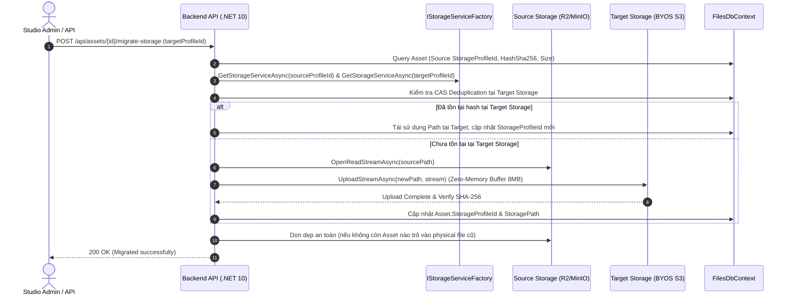

# Kế Hoạch Kỹ Thuật: Chuẩn Bị Triển Khai (Deploy Hardening)
## Bảo Mật Dynamic RabbitMQ Runner, Độc Lập Storage Profile Import/Export Bundle & Chuẩn Hóa Runner Packaging / Versioning

- **Trạng thái:** Sẵn sàng thực hiện (Ready for Execution)
- **Ngày lập:** 12/10/2026
- **Mục tiêu:** Hoàn thiện 4 lỗ hổng và thiếu sót kiến trúc cốt lõi trước khi đóng gói deploy bản dùng thử công khai (Public MVP).

---

## 1. Bối Cảnh & Các Vấn Đề Cần Giải Quyết

Qua quá trình rà soát hệ thống sau Phase 3.3, có 4 vấn đề kỹ thuật trọng yếu cần được xử lý triệt để:

1. **Lỗ hổng bảo mật RabbitMQ Credentials:**
   - Hiện tại `RegisterRunnerWithToken.cs` đang gửi thẳng tài khoản root/admin của Backend API (`SharedRabbitMqConfigHolder.Current`) về lưu trữ tại file `config.json` của máy Runner.
   - Bất kỳ ai có quyền truy cập máy trạm Runner đều có thể đọc tài khoản này và nắm toàn quyền quản trị cụm RabbitMQ (xóa exchange, đọc trộm dữ liệu studio khác).
2. **Lỗi Fallback Storage Profile khi Import Custom Scripts:**
   - Khi Export Pipeline, mã nguồn Python được nhúng thẳng vào JSON bundle. Khi Import vào Project mới, `ImportPipelinePackage` gọi `RequestUploadAsync` mà **không truyền `storageProfileId`** của Project đích.
   - Dẫn tới việc Custom Script luôn bị lưu nhầm vào **Default Storage của Studio**, ngay cả khi Project đích đã cấu hình Storage Bucket riêng (BYOS).
3. **Mất liên kết File Pin & Content khi Import sang Studio/Database khác:**
   - File Parameter và Content Link hiện phụ thuộc vào `assetLinkId` / `contentId` nội bộ của database nguồn. Khi import sang môi trường mới, hệ thống không tìm thấy file và hiện đang **xóa trắng (clear) pin**, khiến người dùng mất dấu tên file gốc.
4. **Quy trình Runner thiếu Versioning, Auto-update & Packaging chuẩn:**
   - Server phân phối file zip mã nguồn thô của thư mục `workers/` thay vì release package đã biên dịch sẵn Protobuf và đóng gói chuẩn.
   - Chưa có version handshake trong gRPC stream, Web UI không biết máy nào đang chạy phiên bản cũ và không có cơ chế tự cập nhật từ xa.

---

## 2. Kế Hoạch Triển Khai Chi Tiết

```mermaid
flowchart TD
    subgraph Phase 1: RabbitMQ Security
        A[Runner Register Token] --> B[Generate Dynamic User & Secure Password]
        B --> C[Provision User & Scoped Permissions via RabbitMQ HTTP API]
        C --> D[Return Isolated Credentials to Runner Config]
    end

    subgraph Phase 2: Pipeline Bundle & Storage
        E[Export Pipeline Bundle] --> F[Pack Scripts & File Pin Metadata]
        F --> G[Import Pipeline Package]
        G --> H[Query Project BYOS StorageProfileId]
        H --> I[Upload Script to Target Project Storage]
        G --> J[Graceful Unbound State for Missing External File Pins]
    end

    subgraph Phase 3: Runner Lifecycle & Packaging
        K[Runner Handshake] --> L[Report AppVersion in AgentMessage]
        L --> M[Web UI Displays Runner Version & Update Badge]
        M --> N[Release Packaging Script & In-place Auto-update]
    end
```



---

### 🔹 GIAI ĐOẠN 1: Bảo Mật Cấp Phát Tài Khoản RabbitMQ Động Cho Runner (Dynamic Least-Privilege Provisioning)

#### 1. Mục tiêu
- Cấp cho mỗi máy Runner một tài khoản RabbitMQ riêng biệt với mật khẩu sinh ngẫu nhiên.
- Giới hạn quyền nghiêm ngặt: Runner chỉ được đọc hàng đợi của chính nó và chỉ được gửi tin nhắn vào exchange phản hồi trạng thái.
- Thu hồi tài khoản tức thì khi xóa Runner.

#### 2. Thiết kế chi tiết
- **Dịch vụ quản lý RabbitMQ Management API (`IRabbitMqProvisioningService`)**:
  - Giao tiếp với RabbitMQ Management HTTP API (mặc định cổng `15672`).
  - `CreateRunnerUserAsync(string username, string password, string vhost, Guid runnerId)`:
    - `PUT /api/users/{username}`: Tạo user không có quyền quản trị (`tags: []`).
    - `PUT /api/permissions/{vhost}/{username}`:
      - **Configure**: `^$` (không được tạo/sửa/xóa cấu trúc hàng đợi).
      - **Write**: `^(pipeline\.events|amq\.default)$` (chỉ được gửi event kết thúc hoặc gửi trực tiếp vào exchange hệ thống cho phép).
      - **Read**: `^(runner\.{runnerId}\..*|pipeline\.jobs\..*)$` (chỉ được consume từ queue riêng).
  - `DeleteRunnerUserAsync(string username)`:
    - `DELETE /api/users/{username}`: Xóa tài khoản khi Runner bị hủy liên kết.
- **Tích hợp vào Luồng Đăng Ký (`RegisterRunnerWithToken.cs`)**:
  - Khi token được xác thực thành công:
    - Sinh username dạng `rn_{runnerId:N}`.
    - Sinh password ngẫu nhiên 32 ký tự bằng `RandomNumberGenerator`.
    - Gọi `provisioningService.CreateRunnerUserAsync(...)`.
    - Trả về `RabbitMqConfigDto` chứa thông tin user/pass riêng này.
- **Cơ chế Dev/Fallback**:
  - Nếu RabbitMQ Management API không được bật hoặc cấu hình tắt trong môi trường Local Dev: Fallback dùng shared config holder kèm cảnh báo rõ ràng trong log.

#### 3. Các tệp thay đổi / tạo mới
- `api/src/SharedKernel/Automation.SharedKernel/Infrastructure/RabbitMq/IRabbitMqProvisioningService.cs` (Tạo mới)
- `api/src/SharedKernel/Automation.SharedKernel/Infrastructure/RabbitMq/RabbitMqManagementService.cs` (Tạo mới)
- `api/src/Modules/Runner/Automation.Runner/Features/Runners/RegisterRunnerWithToken.cs` (Sửa đổi)
- `api/src/Modules/Runner/Automation.Runner/Features/Runners/DeleteRunner.cs` (Sửa đổi)

---

### 🔹 GIAI ĐOẠN 2: Hoàn Thiện Storage Profile Cho Pipeline Bundle & Bảo Toàn File Pin ✅ (ĐÃ HOÀN THÀNH 100%)

#### 1. Mục tiêu
- Khi import Pipeline, Custom Scripts phải được lưu chính xác vào Storage Profile của Project đích thay vì mặc định Studio.
- Khi export/import sang môi trường khác, File Pin không bị xóa trắng mà giữ lại thông tin gợi ý (Unbound State).

#### 2. Thiết kế chi tiết
- **Độc lập Storage Profile (`ImportPipelinePackage.cs`)**:
  - Gọi `storageProfileId = await projectsApi.GetProjectStorageProfileIdAsync(request.ProjectId, ct)`.
  - Truyền `storageProfileId` vào lệnh `assetApi.RequestUploadAsync(scriptUploadItems.Select(x => x.req), storageProfileId, ct)`.
  - Kết quả: Custom Script được lưu đúng MinIO/S3 bucket riêng của Project đích.
- **Bảo toàn File Pin (Metadata Preservation)**:
  - **Khi Export (`ExportPipelineBundle.cs`)**:
    - Quét các config values của node: nếu là File Pin, lấy thêm thông tin `originalFileName`, `sizeBytes`, `hashSha256` từ AssetLink và đóng gói vào `PipelinePackageNodeDto.FilePinsMetadata`.
  - **Khi Import (`ImportPipelinePackage.cs`)**:
    - Nếu `assetApi.ResolveOrCloneLinkAsync` thành công (cùng database): Giữ nguyên link mới.
    - Nếu thất bại (database/studio khác chưa có file):
      - **Tuyệt đối không xóa pin (`configValues.Remove(k)`)**.
      - Đổi giá trị pin thành cấu trúc Unbound:
        ```json
        {
          "status": "unbound",
          "originalFileName": "sample.blend",
          "hashSha256": "...",
          "sizeBytes": 1024
        }
        ```
- **Giao diện Canvas Node (`FormPinFile.tsx` / Node Inspector)**:
  - Nếu pin ở trạng thái `unbound`: Hiển thị viền màu hổ phách (Amber), nhãn cảnh báo: *"Missing file: sample.blend — Please re-select local file"*. Giúp người dùng biết ngay cần bù file gì mà không cần mò lại pipeline ban đầu.

#### 3. Các tệp thay đổi
- `api/src/Modules/Pipeline/Automation.Pipeline/Features/Pipelines/ExportPipelineBundle.cs` (Sửa đổi)
- `api/src/Modules/Pipeline/Automation.Pipeline/Features/Pipelines/ImportPipelinePackage.cs` (Sửa đổi)
- `api/src/Modules/Pipeline/Automation.Pipeline/Features/Pipelines/Dtos/PipelinePackageDtos.cs` (Sửa đổi)
- `web/src/features/pipelines/form-controls/FormPinFile.tsx` (Sửa đổi)

---

### 🔹 GIAI ĐOẠN 3: Chuẩn Hóa Vòng Đời Runner: Version Handshake, Auto-Update & Đóng Gói Release

#### 1. Mục tiêu
- Quản lý phiên bản Runner tập trung từ Server.
- Cung cấp cơ chế tự cập nhật từ Web UI (1-Click Update).
- Đóng gói bản phát hành độc lập (Pre-packaged Artifacts) thay vì nén thư mục mã nguồn thô.

#### 2. Thiết kế chi tiết
- **Runner Version Handshake**:
  - Thêm file `workers/VERSION` chứa phiên bản hiện tại (ví dụ `1.0.0`).
  - Mở rộng Protobuf `packages/proto/agent.proto`:
    ```protobuf
    message AgentMessage {
        string agent_id = 1;
        string app_version = 3;
        oneof payload { ... }
    }
    ```
  - Biên dịch Protobuf (`compile_protos.py`).
  - Lưu `runner.AppVersion` vào database khi Runner kết nối gRPC stream (`RunnerGrpcService.cs`).
  - Cập nhật DTO `RunnerDto` bổ sung `string? AppVersion`.
- **Giao diện Giám Sát Version (`RunnerCard.tsx`)**:
  - Hiển thị Version hiện tại: `v1.0.0`.
  - So sánh với `ServerTargetVersion`: nếu Runner thấp hơn phiên bản máy chủ, hiển thị Badge màu vàng:
    `⚠️ Update Available (v1.1.0)` kèm nút bấm **"Update Runner"**.
- **Kịch bản Đóng Gói Phát Hành (`package_release.py`)**:
  - Tạo script đóng gói chuẩn:
    1. Tự động biên dịch Protobuf.
    2. Gom mã nguồn Python, loại bỏ các file `.git`, `tests`, `cache`, `__pycache__`.
    3. Tạo file `assets/automation-runner-v{VERSION}.zip`.
  - Endpoint `GET /runners/bootstrap/package.zip` ưu tiên phân phối file release đóng gói sẵn này.
- **Cơ chế Tự Cập Nhật Từ Xa (Remote In-Place Update)**:
  - Thêm lệnh gRPC `UpdateRunnerCommand { string download_url = 1; string target_version = 2; }`.
  - Khi Admin bấm "Update Runner" trên Web: Backend gửi lệnh xuống Runner qua stream.
  - Runner tải zip mới về thư mục tạm $\rightarrow$ giải nén ghi đè mã nguồn (bảo tồn nguyên vẹn `config.json` và môi trường venv) $\rightarrow$ tự khởi động lại daemon.

#### 3. Các tệp thay đổi / tạo mới
- `workers/VERSION` (Tạo mới)
- `workers/tools/package_release.py` (Tạo mới)
- `packages/proto/agent.proto` (Sửa đổi)
- `workers/commands/connect.py` (Sửa đổi)
- `workers/handlers/update_handler.py` (Tạo mới)
- `api/src/Modules/Runner/Automation.Runner.Contracts/RunnerDto.cs` (Sửa đổi)
- `api/src/Modules/Runner/Automation.Runner/Domain/Entities/Runner.cs` (Sửa đổi)
- `api/src/Modules/Runner/Automation.Runner/Features/Connections/RunnerGrpcService.cs` (Sửa đổi)
- `web/src/features/runners/components/RunnerCard.tsx` (Sửa đổi)

---

### 🔹 GIAI ĐOẠN 4 (Định Hướng Kiến Trúc Mở Rộng): API Chuyển Đổi Tài Nguyên Giữa Các Storage (Cross-Storage Asset Migration API)

#### 1. Đặt vấn đề & Nhu cầu thực tế
- Khi một Studio / Project chuyển đổi từ **Studio Default Cloud (Cloudflare R2 / MinIO mặc định)** sang **Dedicated BYOS (AWS S3 / Wasabi riêng của khách hàng)**:
  - Các tài nguyên đã tải lên trước đó (3D Meshes, Textures, Custom Scripts, Resource Versions) vẫn nằm ở Storage Profile cũ.
  - Cần cơ chế Server-side cho phép **chuyển đổi (relocate / migrate)** tài nguyên từ Storage cũ sang Storage mới mà **không bắt người dùng phải tải thủ công về máy cá nhân rồi upload lại**.
- Giải quyết bài toán **Replication** khi chia sẻ thư viện mẫu giữa các Studio / Tenant khác nhau.

#### 2. Thiết kế kiến trúc giải pháp



#### 3. Các Endpoint & Hợp đồng dự kiến cho Phase sau:
1. **API Single Asset Relocation**:
   - `POST /api/assets/{id}/migrate-storage`
   - Body: `{ "targetStorageProfileId": "guid-or-null", "deleteSource": true }`
2. **API Project-Level Batch Migration (Background Job)**:
   - `POST /api/projects/{projectId}/storage/migrate`
   - Body: `{ "targetStorageProfileId": "guid-or-null" }`
   - Thực thi qua Background Worker (Wolverine / TickerQ) kèm thanh tiến trình (Progress Tracking) để không làm treo HTTP request khi chuyển dung lượng hàng chục GB.
3. **Mở rộng hợp đồng `IAssetApi`**:
   ```csharp
   Task<Result<AssetDto>> MigrateAssetStorageAsync(
       Guid assetId,
       Guid? targetStorageProfileId,
       bool deleteSource = true,
       CancellationToken ct = default);

   Task<Result<Guid>> StartProjectStorageMigrationJobAsync(
       Guid projectId,
       Guid? targetStorageProfileId,
       CancellationToken ct = default);
   ```

---

## 3. Lộ Trình & Trình Tự Thực Hiện

| Bước | Hạng mục | Thời gian dự kiến | Kết quả nghiệm thu |
| :---: | :--- | :---: | :--- |
| **Bước 1** | Dynamic RabbitMQ Provisioning | Tối nay (Đã hoàn thành ✅) | Mỗi Runner đăng ký có user/pass riêng biệt (`rn_...`), quyền scoped regex, tự teardown khi revoke, không lộ root credentials. |
| **Bước 2** | Fix Storage Profile cho Pipeline Import & Unbound Pin | Tối nay (30m) | Script lưu đúng BYOS Storage của Project đích; file pin giữ nguyên tên file gốc dạng Unbound. |
| **Bước 3** | Runner Version Handshake & Hiển thị trên UI | Tối nay (30-40m) | AgentMessage gửi version, DB lưu AppVersion, Web hiển thị version và badge update. |
| **Bước 4** | Runner Release Packaging & Script Build Release | Ngày mai (45m) | Tạo ra bản zip phân phối sạch sẽ, chuẩn bị sẵn sàng đẩy lên GitHub Release. |
| **Bước 5** | Cross-Storage Asset Migration API (Phase sau) | Phase kế tiếp | API chuyển đổi tài nguyên server-side giữa các Storage Profile không qua máy client. |

---

## 4. Kịch Bản Nghiệm Thu (Acceptance Criteria)

1. **Bảo mật RabbitMQ:**
   - Đăng ký máy Runner mới qua Token $\rightarrow$ kiểm tra bảng điều khiển RabbitMQ xuất hiện user `rn_...` chỉ có quyền read queue riêng và write exchange `pipeline.events`.
   - File `config.json` trên máy Runner không còn chứa username/password của hệ thống.
2. **Storage Profile & Pipeline Import:**
   - Tạo Project mới có Storage Profile BYOS (MinIO bucket riêng).
   - Import một bundle có Custom Script $\rightarrow$ Kiểm tra file `.py` được lưu đúng trong bucket của Project đó.
   - Kiểm tra các File Pin không bị xóa trắng mà hiển thị cảnh báo Unbound kèm tên file gốc.
3. **Runner Version:**
   - Khởi động Runner $\rightarrow$ Runner Card trên Web hiển thị `Version: v1.0.0` và trạng thái `Online`.

