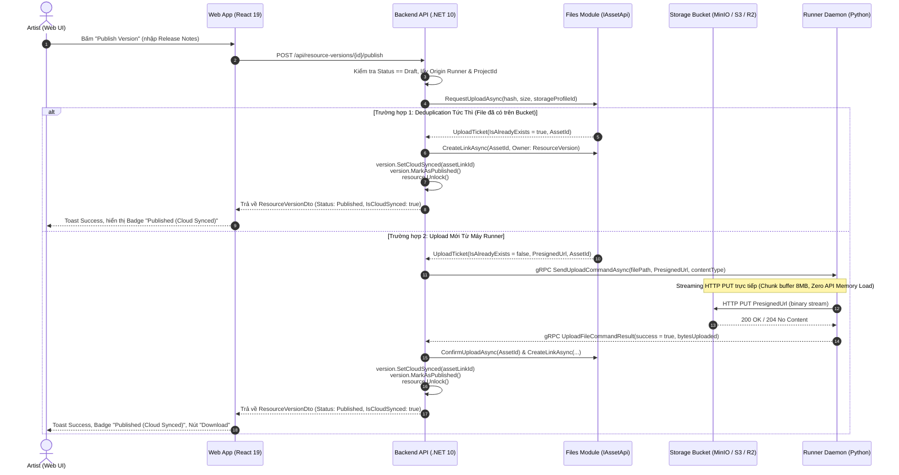

# Kế Hoạch Triển Khai Kỹ Thuật Chi Tiết: Phase 3.3
## Luồng Publish End-to-End (Web $\leftrightarrow$ API $\leftrightarrow$ Runner Daemon)

> **Dự án:** Monorepo Automation Studio  
> **Phạm vi tác động:** `packages/proto/`, `workers/`, `api/` (.NET 10 VSA), `web/` (React 19 / TanStack)  
> **Mục tiêu cốt lõi:** Kết nối trọn vẹn luồng xuất bản (Publish) một Resource Version từ bản nháp cục bộ (`Draft`) trên máy Runner $\rightarrow$ Streaming tải lên Cloud Storage (Studio Cloud Quota / Custom BYOS S3) $\rightarrow$ Khóa phiên bản bất biến (`Published`), xác nhận đồng bộ (`IsCloudSynced`), gỡ Smart Collaborative Lock, và cung cấp tải tệp (`Download Asset`) an toàn trên Web UI.

---

## 1. Kiến Trúc & Sơ Đồ Luồng Dữ Liệu (End-to-End Architecture)



---

## 2. Chi Tiết Các Hạng Mục Triển Khai (Work Breakdown Structure)

### 🔹 Bước 1: Mở Rộng Hợp Đồng gRPC Protobuf (`packages/proto/agent.proto`)
- **Mục tiêu:** Cung cấp thông điệp chuẩn hóa để API Server chỉ thị Runner Daemon thực hiện streaming upload tệp vật lý lên Cloud thông qua Presigned URL.
- **Tệp thay đổi:**
  - [agent.proto](file:///d:/FullStack/Automation/packages/proto/agent.proto)
- **Nội dung bổ sung:**
  1. Thêm trường payload vào `ServerMessage`:
     ```protobuf
     message ServerMessage {
         oneof payload {
             ScanCommand scan_command = 1;
             BrowseCommand browse_command = 2;
             ScanExecutorsCommand scan_executors_command = 3;
             ScanHardwareCommand scan_hardware_command = 4;
             UploadFileCommand upload_file_command = 5; // <-- Bổ sung
         }
     }
     ```
  2. Định nghĩa cấu trúc `UploadFileCommand`:
     ```protobuf
     message UploadFileCommand {
         string command_id = 1;
         string file_path = 2;          // Đường dẫn tệp tuyệt đối trên ổ cứng máy Runner
         string presigned_url = 3;       // Presigned S3/R2 PUT URL
         string content_type = 4;        // MIME type (application/octet-stream, ...)
         string asset_id = 5;            // ID của Asset được khởi tạo ở IAssetApi
         string resource_version_id = 6; // ID của ResourceVersion
     }
     ```
  3. Thêm trường kết quả vào `CommandResponse`:
     ```protobuf
     message CommandResponse {
         string command_id = 1;
         bool success = 2;
         string error_message = 3;

         oneof result {
             ...
             UploadFileCommandResult upload_file_result = 8; // <-- Bổ sung
         }
     }
     ```
  4. Định nghĩa `UploadFileCommandResult`:
     ```protobuf
     message UploadFileCommandResult {
         string asset_id = 1;
         string resource_version_id = 2;
         int64 bytes_uploaded = 3;
     }
     ```
- **Biên dịch Protobuf:**
  - Chạy `python workers/tools/compile_protos.py` cập nhật mã Python `workers/core/agent_pb2.py` và `agent_pb2_grpc.py`.
  - .NET API tự động biên dịch lại C# via MsBuild khi build project.

---

### 🔹 Bước 2: Python Runner Daemon Streaming Upload (`workers/`)
- **Mục tiêu:** Runner tiếp nhận lệnh upload, đọc tệp nhị phân từ ổ đĩa và streaming HTTP PUT trực tiếp lên Presigned URL mà không giữ toàn bộ tệp vào RAM.
- **Tệp tạo mới / sửa đổi:**
  - `workers/handlers/upload_handler.py` (**Tạo mới**)
  - `workers/handlers/__init__.py` (**Sửa đổi**)
  - `workers/commands/connect.py` (**Sửa đổi**)
- **Chi tiết xử lý:**
  1. **Tạo `upload_handler.py`**:
     - Kiểm tra file vật lý tồn tại (`os.path.exists(command.file_path)`). Nếu không tồn tại $\rightarrow$ trả về `success = False, error_message = "Local file not found"`.
     - Lấy dung lượng file: `file_size = os.path.getsize(command.file_path)`.
     - Mở file dưới dạng binary stream (`open(command.file_path, "rb")`).
     - Gửi streaming HTTP PUT bằng `requests.put` với file stream binary:
       - Header `Content-Type: command.content_type`.
       - Header `Content-Length: str(file_size)`.
     - Kiểm tra HTTP Status: nếu `200 <= status_code < 300` $\rightarrow$ upload thành công.
     - Trả về `agent_pb2.CommandResponse` chứa `UploadFileCommandResult`.
  2. **Đăng ký vào Dispatcher (`connect.py`)**:
     - Bắt case `payload_case == "upload_file_command"` $\rightarrow$ gọi `handle_upload(server_msg.upload_file_command)`.

---

### 🔹 Bước 3: Nâng Cấp Module Runner (`api/src/Modules/Runner`)
- **Mục tiêu:** Mở rộng `IRunnerApi` để các module khác có thể điều phối lệnh upload xuống máy Runner thông qua kết nối gRPC stream đang hoạt động.
- **Tệp thay đổi:**
  - [IRunnerApi.cs](file:///d:/FullStack/Automation/api/src/Modules/Runner/Automation.Runner.Contracts/IRunnerApi.cs)
  - [RunnerDtos.cs](file:///d:/FullStack/Automation/api/src/Modules/Runner/Automation.Runner/Shared/Dtos/RunnerDtos.cs)
  - [RunnerApiService.cs](file:///d:/FullStack/Automation/api/src/Modules/Runner/Automation.Runner/Infrastructure/Services/RunnerApiService.cs)
- **Chi tiết xử lý:**
  1. Thêm DTO hợp đồng:
     ```csharp
     public record RunnerUploadResultDto(
         string CommandId,
         bool Success,
         string? ErrorMessage,
         long BytesUploaded
     );
     ```
  2. Thêm method vào `IRunnerApi`:
     ```csharp
     Task<Result<RunnerUploadResultDto>> SendUploadCommandAsync(
         Guid runnerId,
         string filePath,
         string presignedUrl,
         string contentType,
         Guid assetId,
         Guid resourceVersionId,
         CancellationToken ct = default
     );
     ```
  3. Triển khai trong `RunnerApiService`:
     - Kiểm tra Runner có kết nối gRPC (`registry.TryGet(runnerId, out var connection)`).
     - Khởi tạo `UploadFileCommand`, đăng ký `CommandTracker`.
     - Ghi vào `connection.ResponseStream.WriteAsync(...)`.
     - Đợi phản hồi `CommandResponse` và trả về kết quả.

---

### 🔹 Bước 4: Mở Rộng Entity & Migration `Automation.Repository`
- **Mục tiêu:** Lưu trữ trạng thái liên kết Cloud Asset và cờ xác nhận đồng bộ trên từng phiên bản Resource.
- **Tệp thay đổi:**
  - [ResourceVersion.cs](file:///d:/FullStack/Automation/api/src/Modules/Repository/Automation.Repository/Domain/Entities/ResourceVersion.cs)
  - [ResourceDtos.cs](file:///d:/FullStack/Automation/api/src/Modules/Repository/Automation.Repository/Shared/Dtos/ResourceDtos.cs)
- **Chi tiết:**
  1. Bổ sung vào `ResourceVersion`:
     ```csharp
     public Guid? AssetLinkId { get; set; }
     public bool IsCloudSynced { get; set; } = false;

     public void SetCloudSynced(Guid assetLinkId)
     {
         AssetLinkId = assetLinkId;
         IsCloudSynced = true;
         UpdatedAt = DateTimeOffset.UtcNow;
     }
     ```
  2. Bổ sung vào `ResourceVersionDto`:
     ```csharp
     public record ResourceVersionDto(
         ...
         Guid? AssetLinkId = null,
         bool IsCloudSynced = false
     );
     ```
  3. Tạo EF Core Migration cho `Automation.Repository`:
     - Tên migration: `AddAssetLinkAndCloudSyncToResourceVersion`.
     - Áp dụng migration lên PostgreSQL database.

---

### 🔹 Bước 5: Tái Cấu Trúc Slice `PublishResourceVersion`
- **Mục tiêu:** Điều phối toàn bộ quy trình xuất bản, bảo đảm tính nhất quán dữ liệu, xử lý tối ưu cả 2 nhánh (Deduplication tức thì vs Streaming upload).
- **Tệp thay đổi:**
  - [PublishResourceVersion.cs](file:///d:/FullStack/Automation/api/src/Modules/Repository/Automation.Repository/Features/ResourceVersions/PublishResourceVersion.cs)
- **Chi tiết luồng xử lý trong `PublishResourceVersionHandler`:**
  1. **Kiểm tra nghiệp vụ:**
     - `version.Status` phải là `Draft`.
     - Tra cứu `originLocation = version.Locations.FirstOrDefault(x => x.IsOrigin) ?? version.Locations.FirstOrDefault()`.
     - Ghép đường dẫn vật lý: `fullPath = Path.Combine(originLocation.RepositoryRunner.RootPath, version.Resource.RelativePath)`.
     - Tra cứu `projectId = version.Resource.Repository.ProjectId`.
     - Lấy `storageProfileId` qua `IProjectsApi.GetProjectStorageProfileIdAsync(projectId)`.
  2. **Kiểm tra trạng thái máy Runner:**
     - Gọi `IRunnerApi` kiểm tra máy Runner sở hữu file có đang online không.
     - Nếu offline $\rightarrow$ trả về lỗi: *"Cannot publish version: Runner machine hosting the local source file is currently offline. Please ensure runner daemon is connected."*
  3. **Yêu cầu Upload Ticket (`IAssetApi.RequestUploadAsync`):**
     - Truyền `FileHash`, `SizeBytes`, `Extension`, `storageProfileId`.
     - Nhận về `AssetUploadDto`:
  4. **Phân nhánh xử lý:**
     - **Nhánh A (`IsAlreadyExists == true` - Deduplication Tức Thì):**
       - Tệp cùng hash đã có trên bucket lưu trữ.
       - Gọi `IAssetApi.CreateLinkAsync` gắn Asset vào `ResourceVersion`.
       - `version.SetCloudSynced(assetLinkId)`.
       - `version.MarkAsPublished(cmd.Notes)`.
       - `version.Resource.Unlock()`.
       - Lưu DB $\rightarrow$ Bắn `ResourceVersionPublishedEvent` $\rightarrow$ Trả về kết quả ngay.
     - **Nhánh B (`IsAlreadyExists == false` - Cần tải lên vật lý):**
       - Gọi `runnerApi.SendUploadCommandAsync(runnerId, fullPath, ticket.PresignedUrl, contentType, ticket.AssetId, version.Id)`.
       - Sau khi Runner upload thành công:
         - Gọi `IAssetApi.ConfirmUploadAsync([new(ticket.AssetId, fileName)])`.
         - Gọi `IAssetApi.CreateLinkAsync(...)` liên kết `AssetLink`.
         - `version.SetCloudSynced(assetLinkId)`.
         - `version.MarkAsPublished(cmd.Notes)`.
         - `version.Resource.Unlock()`.
         - Lưu DB $\rightarrow$ Bắn `ResourceVersionPublishedEvent` $\rightarrow$ Trả về kết quả hoàn tất.

---

### 🔹 Bước 6: Endpoint & Cơ Chế Tải Tệp (`Download Asset`)
- **Mục tiêu:** Cung cấp link tải xuống an toàn (Presigned GET URL hoặc Public URL) cho người dùng trên Web UI khi xem một phiên bản đã xuất bản.
- **Tệp tạo mới:**
  - `api/src/Modules/Repository/Automation.Repository/Features/ResourceVersions/GetResourceVersionDownloadUrl.cs`
- **Chi tiết:**
  1. `GET /api/resource-versions/{id}/download-url`:
     - Kiểm tra `version.IsCloudSynced && version.AssetLinkId.HasValue`.
     - Lấy `AssetLink` từ `IAssetApi.GetLinksByIdsAsync`.
     - Lấy thông tin `Asset` $\rightarrow$ sinh Presigned Download URL qua `IStorageServiceFactory` (hoặc Public URL nếu có cấu hình).
     - Trả về DTO: `{ downloadUrl: string, fileName: string, sizeBytes: long }`.

---

### 🔹 Bước 7: Cập Nhật Web Frontend UI (`web/`)
- **Mục tiêu:** Hiển thị trực quan trạng thái Cloud Sync, hỗ trợ tải tệp về máy, và cung cấp phản hồi mượt mà khi xuất bản.
- **Tệp thay đổi:**
  - [useRepositories.ts](file:///d:/FullStack/Automation/web/src/features/repositories/hooks/useRepositories.ts): Thêm hook `useDownloadResourceVersion`.
  - [ResourceDetailPage.tsx](file:///d:/FullStack/Automation/web/src/features/repositories/pages/ResourceDetailPage.tsx):
    - Cập nhật Badges:
      - `Draft` (Hổ phách - Amber).
      - `Published (Cloud Synced)` (Xanh ngọc - Emerald kèm icon mây).
    - Thêm nút hành động **"Download Asset"** (icon `DownloadCloud` hoặc `Download`) cạnh các phiên bản đã xuất bản và đã đồng bộ Cloud.
  - [PublishVersionDialog.tsx](file:///d:/FullStack/Automation/web/src/features/repositories/dialogs/PublishVersionDialog.tsx):
    - Hiển thị thông tin Storage đích (Studio Cloud hay Custom BYOS).
    - Trạng thái loading hiển thị rõ ràng: *"Publishing and streaming upload to cloud storage..."*.

---

## 3. Kịch Bản Kiểm Thử & Nghiệm Thu (Verification Plan)

| STT | Kịch Bản Thử Nghiệm | Thao Tác | Kết Quả Mong Đợi |
| :---: | :--- | :--- | :--- |
| **TC1** | **Publish khi Runner Offline** | Tắt Runner daemon $\rightarrow$ Bấm Publish Version trên Web. | API chặn lại và trả về thông báo lỗi rõ ràng yêu cầu khởi động Runner. Phiên bản vẫn ở trạng thái Draft. |
| **TC2** | **Publish có CAS Deduplication** | Đã có một asset cùng file hash trên S3 $\rightarrow$ Bấm Publish Version trên Web. | Không phát sinh lệnh upload xuống Runner. Phiên bản được Publish và gắn `IsCloudSynced = true` ngay lập tức trong vài chục ms. |
| **TC3** | **Publish kèm Streaming Upload** | Runner daemon đang chạy $\rightarrow$ Bấm Publish Version một tệp `.blend` mới. | Runner nhận gRPC `UploadFileCommand`, streaming HTTP PUT lên presigned URL, trả về thành công. API xác nhận `ConfirmUpload`, version chuyển sang `Published` và `IsCloudSynced = true`. Smart lock được gỡ bỏ. |
| **TC4** | **Tải xuống Asset từ Web** | Tại phiên bản đã Publish $\rightarrow$ Bấm nút "Download Asset". | API trả về Presigned Download URL, trình duyệt kích hoạt tải tệp nhị phân về máy an toàn, dung lượng và định dạng khớp 100%. |
| **TC5** | **Kiểm thử Hồi Quy (Regression Tests)** | Chạy toàn bộ test suites `Automation.Files.Tests` và `Automation.Repository.Tests`. | 100% test cases pass sạch, không có hồi quy logic. |
