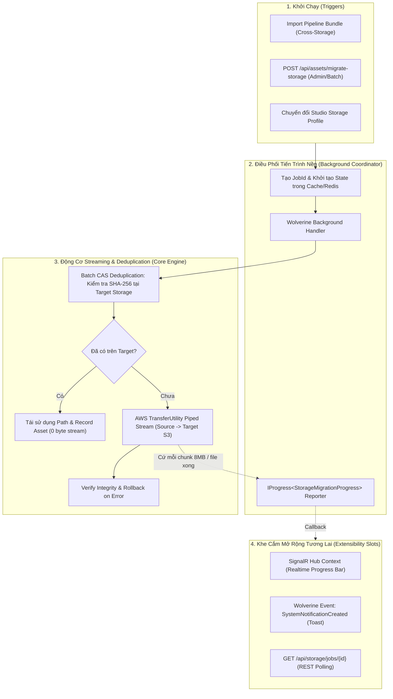

# Kế Hoạch Kỹ Thuật: Di Chuyển Dữ Liệu Lưu Trữ Hàng Loạt & Theo Dõi Tiến Trình Nền
## (Batch Cross-Storage Asset Migration & Background Progress Pipeline)

- **Trạng thái:** Sẵn sàng thực hiện (Ready for Execution)
- **Ngày lập:** 13/10/2026
- **Phạm vi:** `Automation.Files`, `Automation.Pipeline`, `Automation.SharedKernel`
- **Mục tiêu:** Xây dựng cơ chế di chuyển/sao chép Asset vật lý hàng loạt giữa các Storage Profile (Cloud mặc định, BYOS AWS S3, MinIO On-Premise) với công nghệ Piped Streaming (Zero-memory/Zero-disk buffer), Deduplication SHA-256, và cơ chế theo dõi tiến trình nền linh hoạt (sẵn sàng cắm SignalR/Notification).

---

## 1. Bối Cảnh & Đặt Vấn Đề

1. **Giới hạn của Clone `AssetLink`:**
   - Hệ thống hiện tại tối ưu sao chép logic cực tốt bằng `ResolveOrCloneLinkAsync` (Zero-byte copy) khi làm việc trong **cùng một Storage Profile**.
   - Tuy nhiên, khi chuyển Pipeline/Resource sang **Storage Profile độc lập của khách hàng (BYOS - Bring Your Own Storage)** hoặc chuyển giữa 2 Studio khác nhau, file nhị phân chưa hề tồn tại ở Storage đích. Nếu chỉ tạo `AssetLink` thì Worker sẽ bị lỗi `404 Not Found` khi tải file.

2. **Các thách thức khi di chuyển dữ liệu lớn (3D Assets vài GB):**
   - **Tràn RAM / Tràn ổ đĩa đệm:** Đọc toàn bộ file vào `byte[]` hoặc tải về ổ cứng tạm sẽ làm tê liệt server API khi nhiều user cùng migrate.
   - **Lãng phí băng thông:** Nếu Storage đích đã có file đó (trùng mã SHA-256), việc truyền lại qua mạng là thừa thãi.
   - **Treo HTTP Request:** Chuyển hàng chục GB qua HTTP request thông thường sẽ gây timeout gateway.
   - **Broken State:** Mạng chập chờn giữa chừng khiến file đích bị hỏng và không thể rollback.

---

## 2. Kiến Trúc Giải Pháp Tổng Thể



---

## 3. Thiết Kế Chi Tiết Từng Tầng

### 🔹 Tầng 1: Low-Level Streaming Storage (`Automation.Files/Infrastructure/Storage`)

Mở rộng `IObjectStorageService` và `S3StorageService`:

```csharp
public interface IObjectStorageService
{
    // ... các phương thức hiện có ...

    /// <summary>
    /// Mở ReadStream trực tiếp từ Storage (kết nối trực tiếp, không buffer toàn bộ vào RAM)
    /// </summary>
    Task<Stream> OpenReadStreamAsync(string storagePath, CancellationToken ct = default);

    /// <summary>
    /// Upload dữ liệu từ Stream thẳng lên Storage sử dụng AWS Multipart Upload (chunk 8MB - 16MB)
    /// </summary>
    Task UploadStreamAsync(
        string storagePath, 
        Stream contentStream, 
        string contentType, 
        long? expectedLength = null,
        CancellationToken ct = default);

    /// <summary>
    /// Kiểm tra nhanh file vật lý có tồn tại trên Storage không
    /// </summary>
    Task<bool> ExistsAsync(string storagePath, CancellationToken ct = default);
}
```

* **Hiện thực trong `S3StorageService`:**
  - Dùng `GetObjectAsync` để lấy `response.ResponseStream`.
  - Dùng `TransferUtility.UploadAsync` với cấu hình `PartSize = 8MB` để streaming trực tiếp từ `inputStream` sang Target S3 mà không cần file tạm trên ổ cứng server.

---

### 🔹 Tầng 2: Core Batch Migration Contract & Engine (`IAssetApi`)

Contract chuẩn Batch-First trong [IAssetApi.cs](file:///d:/FullStack/Automation/api/src/Modules/Files/Automation.Files.Contracts/IAssetApi.cs):

```csharp
public record MigrateAssetItem(
    Guid AssetId,
    bool DeleteSource = false // true = Move (dọn nguồn sau khi sang đích), false = Copy
);

public record MigrateAssetItemResult(
    Guid SourceAssetId,
    Guid? MigratedAssetId,
    string? StoragePath,
    bool IsSuccess,
    bool WasDeduplicated,
    string? ErrorMessage
);

public record StorageMigrationProgress(
    Guid JobId,
    int TotalItems,
    int ProcessedItems,
    long TransferredBytes,
    long TotalBytes,
    string CurrentFileName,
    double Percentage
);

public interface IAssetApi
{
    // ...
    /// <summary>
    /// Di chuyển hoặc sao chép hàng loạt (Batch) Asset vật lý giữa các Storage Profile.
    /// Hỗ trợ CAS Deduplication SHA-256, Piped Stream không đệm đĩa, và báo cáo tiến độ qua IProgress.
    /// </summary>
    Task<Result<IReadOnlyList<MigrateAssetItemResult>>> MigrateAssetsStorageAsync(
        IEnumerable<MigrateAssetItem> items,
        Guid? targetStorageProfileId,
        IProgress<StorageMigrationProgress>? progress = null,
        Guid? trackingJobId = null,
        CancellationToken ct = default
    );
}
```

#### Quy trình xử lý bên trong `AssetApiService`:
1. **Load Metadata:** Lấy danh sách `Asset` theo batch `AssetId`.
2. **Khởi tạo Dịch vụ:** Dùng `IStorageServiceFactory` lấy `sourceService` cho từng profile nguồn và `targetService` cho `targetStorageProfileId`.
3. **CAS Deduplication:** 
   - Truy vấn database: `_db.Assets.FirstOrDefaultAsync(a => a.StorageProfileId == targetStorageProfileId && a.HashSha256 == asset.HashSha256)`.
   - Nếu đã có file ở target: Tạo bản ghi `Asset` mới trỏ vào `StoragePath` đã có, đánh dấu `WasDeduplicated = true`, không tốn 1 byte băng thông!
4. **Streaming Transfer:**
   - Nếu chưa có: Tạo `newStoragePath = $"assets/{DateTime.UtcNow:yyyy/MM}/{Guid.NewGuid()}{extension}"`.
   - Mở `sourceStream = await sourceService.OpenReadStreamAsync(asset.StoragePath, ct)`.
   - Pipe sang target: `await targetService.UploadStreamAsync(newStoragePath, sourceStream, asset.ContentType, asset.SizeBytes, ct)`.
5. **Ghi nhận DB & Dọn dẹp:**
   - Tạo bản ghi `Asset` mới trên target.
   - Nếu `DeleteSource == true`: Xóa file vật lý trên source và cập nhật/xóa bản ghi cũ an toàn.
   - Cập nhật tiến độ `progress?.Report(...)`.

---

### 🔹 Tầng 3: Quản Lý Tiến Trình Nền (Background Job Coordinator)

Xây dựng bộ theo dõi tiến trình `IStorageMigrationJobTracker` (lưu state vào Redis / In-Memory Cache):

```csharp
public enum StorageMigrationJobStatus
{
    Pending,
    Running,
    Completed,
    Failed,
    Cancelled
}

public class StorageMigrationJobState
{
    public Guid JobId { get; set; }
    public StorageMigrationJobStatus Status { get; set; }
    public Guid? TargetStorageProfileId { get; set; }
    public int TotalItems { get; set; }
    public int ProcessedItems { get; set; }
    public long TotalBytes { get; set; }
    public long TransferredBytes { get; set; }
    public string? CurrentFileName { get; set; }
    public double Percentage { get; set; }
    public List<MigrateAssetItemResult> Results { get; set; } = new();
    public string? ErrorMessage { get; set; }
    public DateTimeOffset CreatedAt { get; set; }
    public DateTimeOffset? CompletedAt { get; set; }
}
```

* **Background Execution via Wolverine:**
  - Command: `StartStorageMigrationCommand(Guid JobId, List<MigrateAssetItem> Items, Guid? TargetStorageProfileId, Guid? UserId)`.
  - Handler: Chạy ngầm trong nền, truyền `Progress<StorageMigrationProgress>` để cập nhật `StorageMigrationJobState`.
  - **Extensibility Hooks:** 
    - Khi có progress update $\rightarrow$ Bắn vào `NotificationHub` / `PipelineExecutionHub` (nếu cần).
    - Khi hoàn thành $\rightarrow$ Publish `SystemNotificationCreatedMessage` để hiện Toast thông báo trên giao diện web.

---

### 🔹 Tầng 4: Tích Hợp Vào Nghiệp Vụ Thực Tế

1. **Pipeline Package Import ([ImportPipelinePackageHandler.cs](file:///d:/FullStack/Automation/api/src/Modules/Pipeline/Automation.Pipeline/Features/Pipelines/ImportPipelinePackage.cs)):**
   - Khi import gói Bundle chứa các File Pin sang Project có Storage Profile khác:
   - Gom danh sách file $\rightarrow$ Gọi `MigrateAssetsStorageAsync(items, targetStorageProfileId)` $\rightarrow$ Remap các `AssetId` mới $\rightarrow$ Tạo `AssetLink` cho từng Node mới của Pipeline.
2. **API Endpoint Tra Cứu & Điều Khiển:**
   - `POST /api/files/assets/migrate` $\rightarrow$ Trả về `HTTP 202 Accepted { "jobId": "..." }`.
   - `GET /api/files/assets/migrate-jobs/{jobId}` $\rightarrow$ Trả về tiến độ và trạng thái chi tiết của Job.

---

## 4. Kế Hoạch Triển Khai Chi Tiết Từng Bước

| Bước | Hạng mục công việc | File can thiệp | Kết quả nghiệm thu |
| :---: | :--- | :--- | :--- |
| **1** | Mở rộng Storage Service hỗ trợ Stream | `IObjectStorageService.cs`<br/>`S3StorageService.cs`<br/>`R2StorageService.cs` | **HOÀN THÀNH ✅**: Thêm `OpenReadStreamAsync`, `UploadStreamAsync` (Multipart chunk 8MB), `ExistsAsync`. |
| **2** | Định nghĩa Contracts & DTOs cho Batch Migration | `Automation.Files.Contracts/IAssetApi.cs`<br/>`MigrateAssetDtos.cs` | **HOÀN THÀNH ✅**: Chuẩn Batch-First `MigrateAssetItem`, `MigrateAssetItemResult`, `StorageMigrationProgress`. |
| **3** | Hiện thực Động Cơ Di Chuyển trong `AssetApiService` | `AssetApiService.cs` | **HOÀN THÀNH ✅**: CAS Deduplication SHA-256, Piped Streaming, Move vs Copy mode, dọn an toàn source file. |
| **4** | Xây dựng Job Tracker & Wolverine Background Handler | `StorageMigrationJobTracker.cs`<br/>`MigrateStorage.cs` | **HOÀN THÀNH ✅**: `IStorageMigrationJobTracker` quản lý trạng thái, kết nối `IProgress<T>` tách biệt core, cắm sẵn slot Toast/SignalR. |
| **5** | Viết FastEndpoints cho Migrate & Query Job | `MigrateStorage.cs` | **HOÀN THÀNH ✅**: `POST /assets/migrate` (202 Accepted) & `GET /assets/migrate-jobs/{jobId}`. |
| **6** | Tích hợp vào Luồng Import Pipeline Bundle | `ImportPipelinePackage.cs` | **HOÀN THÀNH ✅**: Tự động stream migrate file pin sang bucket của Target Project khi cấu hình BYOS. |
| **7** | Viết Unit & Integration Test | `Automation.Files.Tests`<br/>`Automation.Pipeline.Tests` | **HOÀN THÀNH ✅**: `AssetStorageMigrationTests` (5/5 PASSED), `Automation.Files.Tests` (46/46 PASSED), `Pipeline.Tests` (141/141 PASSED). |

---

## 5. Tiêu Chí Nghiệm Thu (Acceptance Criteria)

1. **Hiệu Năng & An Toàn Bộ Nhớ (Zero-Disk / Zero-Memory Leak):**
   - Di chuyển file lớn (> 500MB) không làm tăng đột biến RAM của Web API quá 30MB (do buffer chunk 8MB cố định).
   - Không tạo file rác tạm bợ trên ổ cứng server.
2. **CAS Deduplication:**
   - Chuyển file A từ Storage 1 sang Storage 2.
   - Nếu Storage 2 đã tồn tại file có cùng SHA-256 $\rightarrow$ Thời gian hoàn tất < 50ms, `WasDeduplicated = true`, không upload lại.
3. **Rollback & Integrity:**
   - Nếu ngắt kết nối mạng giữa chừng khi đang stream $\rightarrow$ File dở dang trên Storage đích được xóa sạch, trạng thái Job ghi nhận `Failed` kèm lỗi rõ ràng.
4. **Theo Dõi Tiến Trình Nền:**
   - Endpoint `GET /api/files/assets/migrate-jobs/{jobId}` phản ánh đúng số byte, % tiến độ và danh sách file đã xong.
   - Sẵn sàng tích hợp SignalR push hoặc Notification Toast chỉ với 2-3 dòng code mà không cần đụng lại Core Engine.
