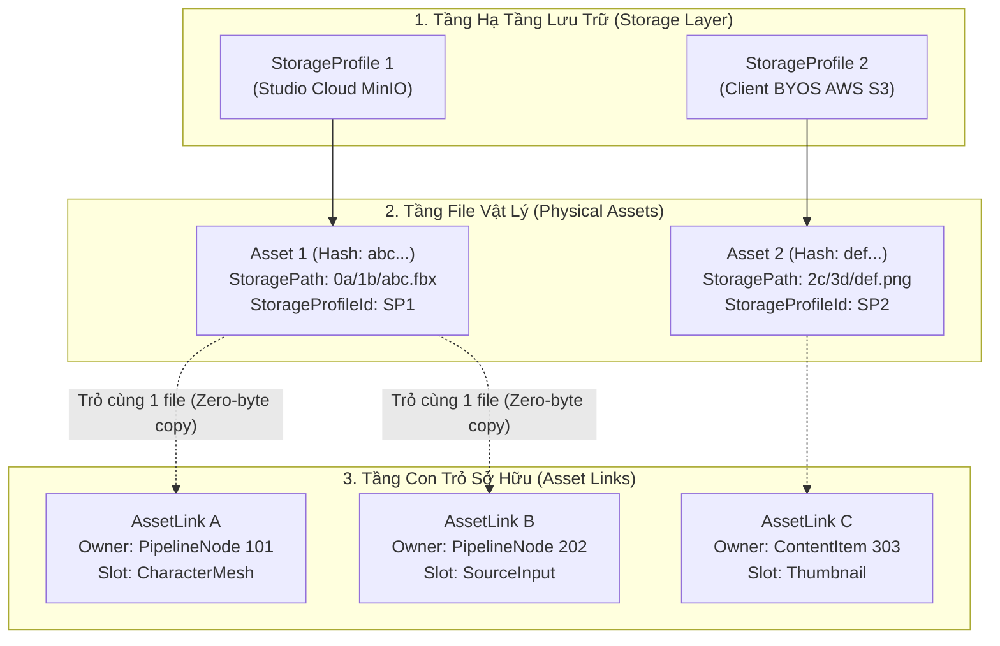
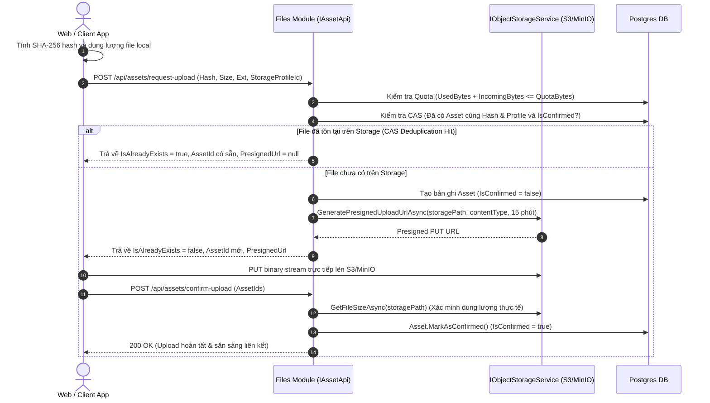
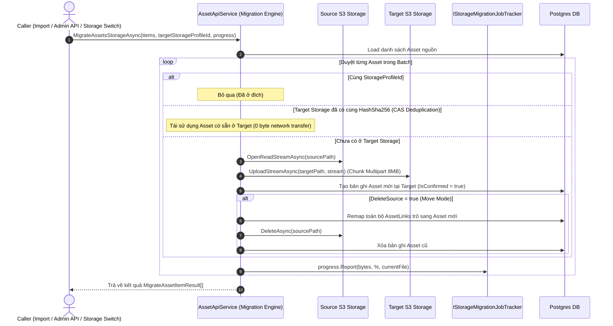

# Files Playbook: Storage Profiles, Asset Lifecycle & Cross-Storage Mobility

> **Phạm vi:** Tài liệu hướng dẫn và kỹ thuật mô tả cốt lõi cách vận hành cho:
> 1. Kiến trúc Phân tầng Dữ liệu: `StorageProfile` (Studio Cloud vs BYOS S3/MinIO), `Asset` (Vật lý & Deduplication) vs `AssetLink` (Con trỏ logic).
> 2. Vòng đời Upload 2 pha: `RequestUpload` (Quota check, Presigned URL, CAS Hash) $\rightarrow$ Direct S3 Upload $\rightarrow$ `ConfirmUpload` (Size validation).
> 3. Cơ chế Sao chép Logic (Zero-Byte Copy): `ResolveOrCloneLinkAsync` và Fallback Unbound Pin.
> 4. Cơ chế Di chuyển Nhị phân Hàng loạt (Batch Cross-Storage Migration): Piped Streaming (Chunk 8MB, 0 disk buffer), CAS Deduplication ở đích, và Background Job State Tracking.
> 5. Cấu trúc mã nguồn tinh gọn: Mô hình `partial class` của `AssetApiService`.
>
> **Quy tắc bắt buộc:** Agent phải đọc tài liệu này trước khi chỉnh sửa bất kỳ tính năng nào liên quan đến Module Files, Storage Profiles, Upload, hoặc Import Pipeline có chứa File Pins. Sau khi sửa code, phải cập nhật lại tài liệu này.

---

## 1. Mental Model: Phân Tầng Hệ Thống Tệp

Hệ thống tệp tách biệt hoàn toàn giữa **dữ liệu nhị phân vật lý** và **quan hệ sở hữu logic**:



### 1.1. Thực Thể Cốt Lõi
- **`StorageProfile`**: Cấu hình kết nối S3/MinIO (ServiceUrl, BucketName, AccessKey, SecretKey, Quota). Hỗ trợ:
  - `StudioCloud`: Kho lưu trữ mặc định của hệ sinh thái, áp dụng hạn ngạch mặc định (mặc định 200MB, cấu hình qua System Settings).
  - `CustomS3 / MinIO (BYOS)`: Kho lưu trữ riêng của từng Studio/Project.
- **`Asset`**: File vật lý đã upload lên bucket, định danh bởi mã băm `HashSha256`, kích thước `SizeBytes`, `StoragePath`, và `StorageProfileId`. File được deduplicate theo `(StorageProfileId, HashSha256)`.
- **`AssetLink`**: Con trỏ logic gắn một `Asset` với một thực thể nghiệp vụ (`OwnerEntityType`, `OwnerEntityId`, `SlotKey`, `OriginalFileName`).

---

## 2. Vòng Đời Upload Tệp 2 Pha (Direct S3 Presigned Flow)

Để Web API không bao giờ phải chịu tải băng thông upload của file 3D nặng hàng GB:



---

## 3. Cơ Chế Sao Chép Logic (Zero-Byte Copy) Khi Duplicate / Import

Khi duplicate hoặc import một Pipeline/Content trong **cùng một Database**:
- Phương thức `ResolveOrCloneLinkAsync(oldAssetLinkId, targetOwner)` được kích hoạt.
- **Nếu cùng Database:**
  - Tra cứu `existingLink`.
  - Không tải lại file, không copy file trên S3.
  - Tạo một bản ghi `AssetLink` mới cho `targetOwner`, trỏ cùng vào `existingLink.AssetId`.
  - **Dung lượng tốn thêm: 0 byte.**
- **Nếu sang Database khác (hoặc link cũ không tồn tại):**
  - Hệ thống báo lỗi `Asset link not found`.
  - Canvas giữ nguyên tên file gốc và tự động chuyển pin sang trạng thái **`Unbound Pin`** (`status = "unbound"`, viền hổ phách) để người dùng kéo thả file mới vào bù đắp mà không bị mất dấu tên file ban đầu.

---

## 4. Cơ Chế Di Chuyển Dữ Liệu Hàng Loạt (Batch Cross-Storage Migration)

Khi chuyển Pipeline/Content sang một **Storage Profile độc lập (BYOS AWS S3 / MinIO riêng của khách)**, file vật lý bắt buộc phải được chuyển sang bucket đích.



### 4.1. Nguyên Tắc Piped Streaming (Zero-Disk / Zero-Memory Leak)
- **Không bao giờ đệm file ra ổ cứng:** Sử dụng stream trực tiếp `response.ResponseStream` từ S3 nguồn chảy qua AWS SDK `TransferUtility` của S3 đích.
- **Giới hạn RAM:** `TransferUtility` tự động cắt luồng thành các chunk multipart 8MB. Dù file nặng 10GB, bộ nhớ RAM tiêu thụ luôn duy trì ở mức tối thiểu (~16MB–32MB) và giải phóng ngay lập tức.

### 4.2. Quản Lý Tiến Trình Nền (Job Coordinator & Extensibility)
- `IStorageMigrationJobTracker`: Quản lý state sống (`JobId`, `Status`, `TotalBytes`, `TransferredBytes`, `Percentage`, `CurrentFileName`).
- Lõi `MigrateAssetsStorageAsync` chỉ tương tác với chuẩn .NET `IProgress<StorageMigrationProgress>`, hoàn toàn không phụ thuộc vào Web UI hay SignalR.
- Khi cần mở rộng:
  - **SignalR Realtime Progress:** Cắm listener vào `IProgress` và gọi `hubContext.Clients.User(...).SendAsync(...)`.
  - **Toast Notification:** Khi hoàn thành, publish `SystemNotificationCreatedMessage` qua Wolverine.
  - **REST Polling:** Endpoint `GET /api/assets/migrate-jobs/{jobId}` trả về trạng thái từ tracker.

---

## 5. Cấu Trúc Mã Nguồn Module Files

Module [Automation.Files](file:///d:/FullStack/Automation/api/src/Modules/Files/Automation.Files) được tổ chức theo kiến trúc VSA và phân rã `partial class`:

```
api/src/Modules/Files/
├── Automation.Files.Contracts/
│   ├── IAssetApi.cs                      <- Hợp đồng facade dùng chung cho toàn Monorepo
│   └── MigrateAssetDtos.cs               <- DTOs Batch migration & Progress tracking
└── Automation.Files/
    ├── Features/Assets/
    │   ├── MigrateStorage.cs             <- Slice VSA: POST /assets/migrate & GET /migrate-jobs/{id}
    │   ├── RequestUpload.cs              <- Slice VSA: POST /assets/request-upload
    │   └── ConfirmUpload.cs              <- Slice VSA: POST /assets/confirm-upload
    └── Infrastructure/
        ├── Tracking/
        │   └── StorageMigrationJobTracker.cs <- Singleton tracker lưu trữ tiến độ Job nền
        ├── Storage/
        │   ├── IObjectStorageService.cs  <- Cung cấp OpenReadStreamAsync & UploadStreamAsync
        │   ├── S3StorageService.cs       <- Hiện thực AWS S3 / MinIO với TransferUtility 8MB
        │   └── StorageServiceFactory.cs  <- Dynamic resolver theo StorageProfileId
        └── AssetApiService*.cs           <- Phân rã partial class:
            ├── AssetApiService.cs           (Khai báo, DI, shared helpers)
            ├── AssetApiService.Links.cs     (Quản lý con trỏ logic & Pins)
            ├── AssetApiService.Uploads.cs   (Presigned URL, Quotas, Confirm)
            ├── AssetApiService.Queries.cs   (Hydration & tra cứu)
            └── AssetApiService.Migration.cs (Piped streaming & Cross-storage)
```
