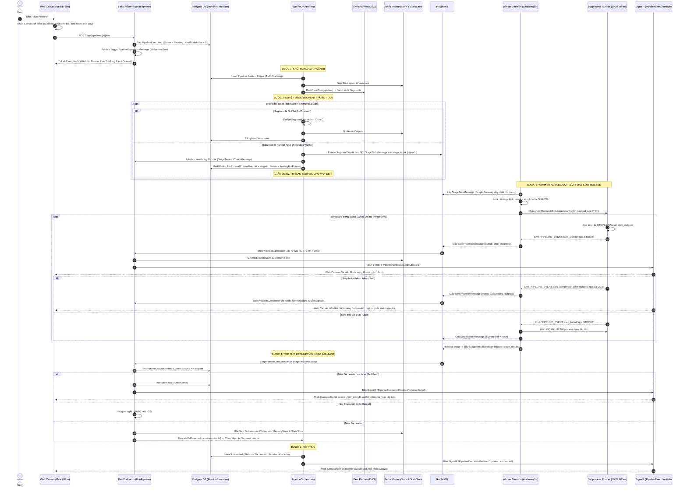
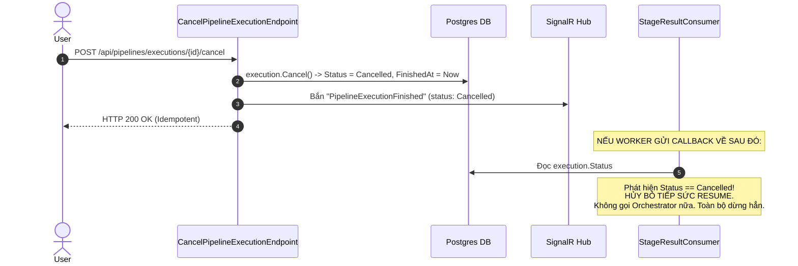

# Pipeline Playbook: Engine Lifecycle & Execution Mechanics

> **Phạm vi:** Tài liệu hướng dẫn và kỹ thuật mô tả cốt lõi cách vận hành cho:
> 1. Vòng đời kích hoạt & thực thi Pipeline (Trigger -> DAG Planner -> Segments -> Finish).
> 2. Các tầng lưu trữ và quản lý tiến trình (`PipelineExecution`, `MemoryStore`, `StateStore`, `EntityStore`).
> 3. Phân biệt các loại Stage & Dispatchers (`DotNetSegmentDispatcher` vs `RunnerSegmentDispatcher`).
> 4. Cơ chế Worker Subprocess & Vòng lặp Tiếp sức (Worker Callback Resumption Loop qua RabbitMQ).
> 5. Cơ chế Hủy Pipeline tinh gọn (Lightweight Cancellation).
>
> **Quy tắc bắt buộc:** Agent phải đọc tài liệu này trước khi can thiệp vào Orchestrator, Dispatchers, Consumers, Worker Runners hoặc Execution State.

---

## 1. Bản Đồ Vòng Đời Thực Thi (End-to-End Lifecycle)



---

## 2. Ai Nắm Giữ Tiến Trình Chạy Pipeline? (State & Storage Topology)

Hệ thống phân tách rạch ròi giữa **Dữ liệu bền vững (Durable State)** và **Dữ liệu sống/Tạm thời (Ephemeral Runtime State)**:

```
┌────────────────────────────────────────────────────────────────────────┐
│ 1. POSTGRES DATABASE (Durable Control State)                          │
│    Entity: PipelineExecution                                           │
│    - Status: Pending | Running | WaitingForRunner | Succeeded | Failed │
│    - NextNodeIndex: Con trỏ chỉ mục Segment kế tiếp cần chạy           │
│    - CurrentBatchId: StageExecutionId hiện tại đang gửi cho Worker    │
│    - FinishedAt & ErrorMessage                                         │
└────────────────────────────────────┬───────────────────────────────────┘
                                     │
┌────────────────────────────────────▼───────────────────────────────────┐
│ 2. EXECUTION MEMORY STORE (IExecutionMemoryStore - Redis / RAM)        │
│    - Start Inputs (tham số đầu vào khi trigger pipeline)               │
│    - Pipeline Variables (biến toàn cục được set qua SetVariableTool)   │
│    - Node Outputs: Kết quả trả về của từng Node sau khi chạy xong       │
│      Key pattern: "execution:{id}:node:{nodeId}:outputs"              │
└────────────────────────────────────┬───────────────────────────────────┘
                                     │
┌────────────────────────────────────▼───────────────────────────────────┐
│ 3. EXECUTION STATE STORE (IExecutionStateStore - Redis / Blob)         │
│    - PipelineExecutionState: Full Snapshot đồ thị dữ liệu tại từng     │
│      checkpoint (phục vụ Audit, Visual Debugger, Inspector)            │
└────────────────────────────────────┬───────────────────────────────────┘
                                     │
┌────────────────────────────────────▼───────────────────────────────────┐
│ 4. EXECUTION ENTITY STORE (IExecutionEntityStore)                      │
│    - In-memory prefetch cache cho các Resource Entities, Metadata      │
│    - Tránh N+1 SQL queries khi hàng chục node cùng truy xuất Resource   │
└────────────────────────────────────────────────────────────────────────┘
```

---

## 3. Phân Biệt Các Loại Stage & Dispatchers

`ExecPlanner` phân tích DAG đồ thị và gom nhóm thành các **`ExecSegment`** (Phân đoạn thực thi). Mỗi Segment được xử lý bởi một Dispatcher chuyên trách:

| Loại Segment / Dispatcher | Môi trường thực thi | Đối tượng node đảm nhiệm | Cách thức hoạt động |
| :--- | :--- | :--- | :--- |
| **`DotNetSegmentDispatcher`** | **In-Process** (RAM Backend C#) | Các built-in Tools C# (`make-map`, `format-string`, `set-variable`, `get-resource-relative-paths`...) | Chạy tức thì qua `IToolRegistry`. Đầu ra lưu ngay vào `MemoryStore`. Không qua RabbitMQ, không tốn tài nguyên worker, không context-switch. |
| **`RunnerSegmentDispatcher`** | **Out-of-Process** (Worker Daemons) | Các Custom Script nodes (`bake-mesh`, `apply-baked-textures`...) | Gom toàn bộ node trong cùng một **Container/Stage** thành một mảng `StepExecution` trong `StageTaskMessage`. Gửi sang RabbitMQ, chuyển DB sang `WaitingForRunner` và **nhả thread server**. |
| **`ForEachDispatcher`** | **Orchestrated Loop** | Node loại ForEach Loop | Tách mảng dữ liệu thành từng iteration, nạp scope index vào MemoryStore và điều phối nhánh lặp. |
| **`SubPipelineDispatcher`** | **Nested Execution** | Node loại SubPipeline | Kích hoạt một Execution độc lập cho Pipeline con, chờ hoàn tất và map outputs ngược lại Pipeline cha. |

---

## 4. Cơ Chế Worker Thực Thi & Tiếp Sức Callback (Resumption Loop)

### 4.1. Kiến Trúc Ambassador / Sidecar Pattern (Worker Daemon & Subprocess 100% Offline)
Nhằm giải quyết triệt để sự cố rò rỉ socket, đứt gRPC channel và treo process của Blender/Unreal Engine, hệ thống áp dụng triệt để mô hình **Ambassador / Sidecar**:
1. **Host Daemon (`pipeline_consumer.py`) - "Đại Sứ Duy Nhất":**
   - Là thực thể duy nhất kết nối mạng, lắng nghe RabbitMQ (`stage_tasks.{agentId}`) và tương tác gRPC/Storage.
   - Quản lý file lock `.storage.lock` bằng context `with storage_lock():` để ngăn cronjob dọn rác xóa trúng file job đang chạy.
   - Phân giải script qua `script_resolver.py` (kiểm tra hash SHA-256 từ `worker/runtime/cache/scripts/{hash}/`).
2. **Subprocess Guest Runner (`stage_runner.py` / `ue_stage_runner.py`) - "100% Offline":**
   - Bị tước bỏ hoàn toàn code gRPC client và socket mạng.
   - **Giao thức STDIN:** Nhận toàn bộ `StageTaskMessage` dạng JSON UTF-8 qua dòng nhập chuẩn `sys.stdin`.
   - **Bộ nhớ đệm RAM `all_step_outputs`:** Kết quả của step trước được lưu trực tiếp vào dictionary trong RAM của Python subprocess, các step sau đọc trực tiếp tại chỗ mà không cần gọi mạng.
   - **Giao thức STDOUT:** Bắn các sự kiện cấu trúc thời gian thực qua dòng xuất chuẩn:
     - `PIPELINE_EVENT: {"event": "step_started", "step_execution_id": "..."}`
     - `PIPELINE_EVENT: {"event": "step_completed", "step_execution_id": "...", "succeeded": true, "outputs": {...}}`
     - `PIPELINE_EVENT: {"event": "step_failed", "step_execution_id": "...", "error_message": "..."}`
3. **Cơ chế Fail-Fast Subprocess Termination:**
   - Khi phát hiện bất kỳ step nào phát `step_failed`, `BaseSubprocessExecutor` lập tức kích hoạt `proc.kill()` để giải phóng GPU/RAM ngay tức khắc (< 1 giây), không để tiến trình tiếp tục chạy vô ích.

### 4.2. Kiến Trúc Zero-DB Hot Path (`StepProgressConsumer`)
Nhằm loại bỏ hoàn toàn hiện tượng nghẽn giao dịch SQL (Race Condition / Deadlock) khi Worker gửi tiến độ dồn dập:
- `StepProgressMessage` mang sẵn đầy đủ ngữ cảnh tự thân: `pipeline_execution_id`, `pipeline_id`, `step_execution_id`, `status`, `outputs`, `error_message`.
- **Tuyệt đối không query `PipelineDbContext`:** Không `SELECT ... FROM PipelineExecutions`, không mở SQL transaction.
- **Ghi nóng vào Redis:**
  - `stateStore.SetNodeStatusAsync(executionId, nodeId, message.Status, ct)`
  - `memoryStore.SetNodeAllOutputsAsync(executionId, nodeId, message.Outputs, scope: null, ct)` (nếu có outputs).
- **Phát sóng SignalR siêu tốc (< 1ms):** Bắn thẳng sự kiện `PipelineNodeExecutionUpdated` vào group `pipeline_{pipelineId}`.

### 4.3. Cơ Chế Fail-Fast SignalR & Resumption Callback (`StageResultConsumer`)
1. **Trường hợp Thất bại (`message.Succeeded == false`):**
   - Đánh dấu `execution.MarkFailed(error)`.
   - Lưu DB: `await db.SaveChangesAsync(ct)`.
   - **BẮT BUỘC BẮN SIGNALR `PipelineExecutionFinished(status: "failed")`** kèm `errorMessage`. Điều này dập tắt ngay spinner trên Web Canvas, tô viền đỏ node lỗi và hiển thị banner thông báo mà không bị treo giao diện.
2. **Trường hợp Thành công (`message.Succeeded == true`):**
   - Cập nhật outputs của tất cả steps vào `IExecutionMemoryStore` và `IExecutionStateStore`.
   - Bắn SignalR `PipelineNodeExecutionUpdated` xác nhận cho từng node.
   - Cập nhật state đồ thị, tăng `NextNodeIndex`, lưu DB và gọi `orchestrator.ExecuteOrResumeAsync(execution.Id)`.

### 4.4. Cơ Chế Stage Timeout Watchdog (Chống Zombie Executions)
- Khi `RunnerSegmentDispatcher` gửi task cho Worker, đồng thời đăng ký một tin nhắn kiểm tra quá hạn sau 30 phút qua Wolverine:
  ```csharp
  await messageBus.PublishAsync(
      new StageTimeoutCheckMessage(execution.Id, stageId),
      new DeliveryOptions { ScheduleDelay = TimeSpan.FromMinutes(30) }
  );
  ```
- **`StageTimeoutHandler`:** Sau 30 phút, nếu execution vẫn ở trạng thái `WaitingForRunner` (hoặc `Running`) và `CurrentBatchId == stageId` (Runner không phản hồi do sập nguồn/crash), hệ thống tự động:
  - Đánh dấu `execution.MarkFailed("Stage timed out: Runner did not report back within 30 minutes.")`.
  - Phát sóng SignalR `PipelineExecutionFinished(status: "failed")` để dọn dẹp tiến trình an toàn.

---

## 5. Cơ Chế Hủy Pipeline Tinh Gọn (Lightweight Cancellation)

Dự án áp dụng nguyên tắc **"Dừng luôn, dứt khoát, không cần resume hay distributed saga"**:



- **Endpoint:** `POST /api/pipelines/executions/{id:guid}/cancel` ([CancelPipelineExecution.cs](file:///d:/FullStack/Automation/api/src/Modules/Pipeline/Automation.Pipeline/Features/Pipelines/CancelPipelineExecution.cs)).
- **Trạng thái:** Chuyển ngay lập tức thành `ExecutionStatus.Cancelled`, ghi nhận `FinishedAt = UtcNow`.
- **Phản hồi UI:** Bắn SignalR `PipelineExecutionFinished` để Canvas UI đổi trạng thái ngay, dừng spinner.
- **Ngắt vòng lặp:** Khi Worker gửi `StageResultMessage` về muộn, `StageResultConsumer` kiểm tra `Status == Cancelled` và từ chối gọi `ExecuteOrResumeAsync`, ngắt hoàn toàn tiến trình.

---

## 6. Cơ Chế Canvas Live Tracking & Khóa An Toàn (Frontend Safety Lock)

Giao diện Web Canvas (`web/src/features/pipelines/components/canvas/`) đồng bộ real-time với Engine qua SignalR:

1. **`ExecutionStatusBanner` (Banner Nổi Giám Sát Tiến Trình):**
   - Nổi bật ở cạnh trên Canvas khi người dùng đang theo dõi một lượt chạy (`activeExecutionId`).
   - Hiển thị huy hiệu trạng thái: `Running` (xanh dương kèm hiệu ứng pulse), `Succeeded` (xanh lá), `Failed` (đỏ), `Cancelled` (vàng xám).
   - Cung cấp nút xem Live Logs (mở Drawer tab Logs) và nút "Back to Draft" để quay lại chế độ chỉnh sửa mẫu pipeline.
2. **`usePipelineLiveTracking` Hook:**
   - Lắng nghe SignalR `PipelineNodeExecutionUpdated`: Đổi màu viền node (Pending -> Running -> Succeeded / Failed) trong < 16ms.
   - Nạp outputs thời gian thực vào node data để hiển thị ngay trong Node Inspector khi người dùng nhấp chọn node.
   - Lắng nghe `PipelineExecutionFinished`: Cập nhật trạng thái tổng thể và dập tắt toàn bộ loading spinner.
3. **Khóa An Toàn Toàn Diện (`isLocked`):**
   - Khi Pipeline đang chạy (`status === Running || status === WaitingForRunner`):
     - Vô hiệu hóa kéo thả node (`nodesDraggable={false}`).
     - Vô hiệu hóa nối dây/kết nối pin (`nodesConnectable={false}`).
     - Vô hiệu hóa phím Delete / Backspace (`deleteKeyCode={null}`).
     - Vô hiệu hóa nút Run và nút Validate trên Toolbar.
     - Đặt Node Inspector sang chế độ chỉ đọc (`isReadOnly={true}`) để ngăn sửa đổi config của node khi pipeline đang thực thi.

---

## 7. Ma Trận Phân Quyền RabbitMQ Least Privilege (Dynamic Permissions)

Để đảm bảo an toàn tuyệt đối khi Worker kết nối từ môi trường trôi nổi, Backend (`RabbitMqManagementService`) cấp quyền động tối thiểu (Least Privilege) cho tài khoản Runner (`rn_{runnerId}`):

| Tài nguyên / Hàng đợi | Quyền Backend (Wolverine/API) | Quyền Runner (Worker Daemon) | Cơ chế & Mục đích vận hành |
| :--- | :--- | :--- | :--- |
| **`stage_tasks.{runnerId}`** | `configure`, `write` | `configure`, `read` | Hàng đợi nhận task chuyên biệt của Runner. Runner là Consumer duy nhất. |
| **`stage_results`** | `configure`, `read` | **`write` (Publish Only)** | Hàng đợi báo cáo kết quả hoàn thành cả Stage. Backend Wolverine sở hữu. |
| **`step_progress`** | `configure`, `read` | **`write` (Publish Only)** | Hàng đợi báo cáo tiến độ từng Step (Zero-DB hot path). Backend Wolverine sở hữu. |
| **`amq.default` (Exchange)**| `read`, `write` | **`write`** | Default Direct Exchange dùng để định tuyến tin nhắn tới queue đích. |

> [!CAUTION]
> **QUY TẮC SỐNG CÒN CHO RUNNER:**
> Runner **TUYỆT ĐỐI KHÔNG ĐƯỢC GỌI** `queue_declare` trên `stage_results` hay `step_progress`. Vì Runner không có quyền `configure` trên 2 hàng đợi này, RabbitMQ sẽ **lập tức ngắt kết nối Channel với lỗi 403 `ACCESS_REFUSED`**, làm đứt toàn bộ chu trình xử lý! Runner chỉ được `queue_declare` hàng đợi của chính mình (`stage_tasks.{runnerId}`).

---

## 8. Ma Trận Chuyển Đổi Trạng Thái & Tín Hiệu (State Machine & Telemetry Matrix)

| Trạng thái | Nơi thiết lập | Điều kiện kích hoạt | SignalR Event | Phản hồi giao diện Canvas (Web UI) |
| :--- | :--- | :--- | :--- | :--- |
| **`Pending`** | FastEndpoints `RunPipeline` | Vừa nhận lệnh POST run | HTTP Response `{ executionId }` | Banner nổi hiện `#<id>`, `isLocked=true`, mở Drawer. |
| **`WaitingForRunner`** | `RunnerSegmentDispatcher` | Đã gửi StageTask vào RabbitMQ | `PipelineExecutionUpdated` | Badge trạng thái `WaitingForRunner`, Server giải phóng thread. |
| **`Running` (Step)** | `StepProgressConsumer` | Subprocess emit `step_started` | `PipelineNodeExecutionUpdated` | Viền Node viền vàng/cam phát sáng pulse, spinner xoay (< 16ms). |
| **`Succeeded` (Step)** | `StepProgressConsumer` | Subprocess emit `step_completed` | `PipelineNodeExecutionUpdated` | Viền Node chuyển sang xanh lá, nạp Outputs vào Node Inspector. |
| **`Succeeded` (Pipeline)** | `PipelineOrchestrator` | Toàn bộ segments hoàn tất | `PipelineExecutionFinished` (succeeded: true) | Banner xanh `Succeeded`, dập tắt spinner, mở khóa Canvas. |
| **`Failed`** | Subprocess Fail-Fast / Timeout | Step lỗi hoặc quá hạn 30 phút | `PipelineExecutionFinished` (succeeded: false) | Viền Node đỏ, Banner đỏ báo lỗi, mở khóa Canvas. |
| **`Cancelled`** | Endpoint `CancelExecution` | Người dùng bấm nút Stop/Cancel | `PipelineExecutionFinished` (status: Cancelled) | Banner chuyển màu xám, ngắt tiếp sức các segment còn lại. |

---

## 9. Tóm Tắt Quy Tắc Vàng Cho Agent Khi Can Thiệp Pipeline Engine

1. **Tuân thủ Zero-DB Hot Path:** Tuyệt đối không đưa câu lệnh SQL hay DbContext vào `StepProgressConsumer`. Tất cả cập nhật runtime giữa các step phải đi qua Redis `StateStore` và `MemoryStore`.
2. **Ambassador Pattern cho Worker:** Guest stage runners (Blender/Unreal) phải chạy 100% offline, đọc task qua STDIN và xuất log qua STDOUT. Tuyệt đối không nhúng kết nối gRPC/mạng vào trong guest script.
3. **Fail-Fast dứt khoát:** Khi gặp lỗi ở bất kỳ tầng nào (Subprocess, Host Worker, hay Backend Consumer), lập tức phát sóng SignalR `PipelineExecutionFinished` để UI dập tắt spinner ngay lập tức.
4. **Luôn có Watchdog Timeout:** Mọi phân đoạn out-of-process gửi sang Worker bắt buộc phải được bảo vệ bởi `StageTimeoutCheckMessage` để triệt tiêu zombie executions.
5. **Khóa an toàn Canvas:** Luôn duy trì cờ `isLocked` trên Frontend Canvas khi có pipeline đang chạy để bảo toàn tính toàn vẹn của đồ thị.
6. **Không tạo thêm bảng quản lý cancel:** Tuyệt đối không tái tạo `StageExecutions` hay `ExecutionCancelCommands`. Cơ chế cancel chỉ dựa trên `Status = Cancelled` và short-circuit tại `StageResultConsumer`.
7. **Tôn trọng Least Privilege của RabbitMQ:** Runner chỉ declare queue của mình (`stage_tasks.{runnerId}`), không bao giờ declare queue kết quả của server.
