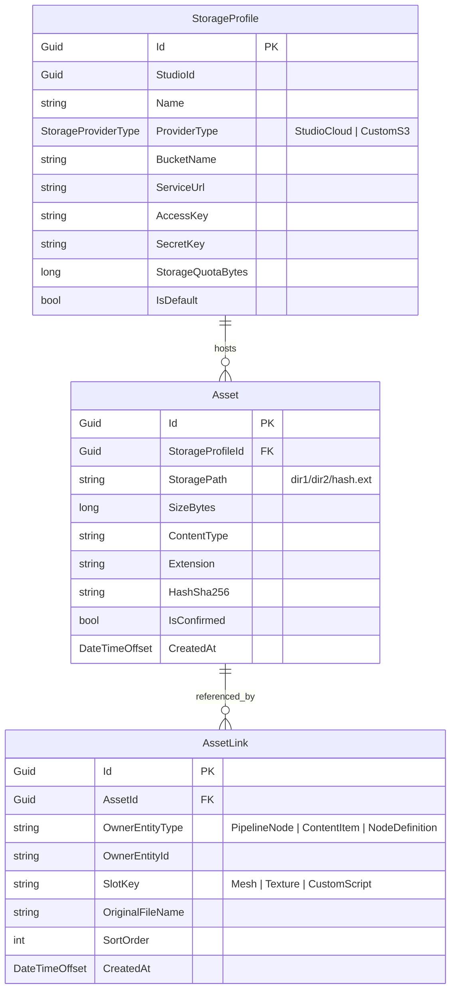

# Kiến Trúc Hệ Thống Lưu Trữ & Vòng Đời Tệp (Files & Storage Architecture)

Tài liệu này ghi lại các quyết định thiết kế kiến trúc, mô hình dữ liệu và cơ chế vận hành của module **`Automation.Files`** trong hệ thống Automation Studio.

---

## 1. Triết Lý Thiết Kế (Core Architectural Principles)

1. **Phân Tách Tuyệt Đối giữa Vật Lý (Asset) và Logic (AssetLink):**
   - File nhị phân trên S3/MinIO không bao giờ bị gắn cứng vào một Pipeline hay một Entity cụ thể.
   - Nhờ đó, một file 3D nặng 5GB có thể được dùng ở hàng chục Node và dự án khác nhau mà chỉ tốn đúng 1 bản copy vật lý (**Zero-byte Copy / CAS Deduplication**).

2. **Server-Bypass Cho Tải Trọng Lớn (Direct Presigned Upload):**
   - Không cho phép client upload file trực tiếp qua Web API.
   - Web API chỉ đóng vai trò cấp vé (Presigned URL) và xác thực dung lượng/hash sau khi client đã tải trực tiếp lên S3/MinIO.

3. **Piped Streaming Cho Dịch Chuyển Dữ Liệu (Zero-Disk / Zero-Memory Leak):**
   - Khi di chuyển file giữa 2 Storage Profile (ví dụ: chuyển từ Cloud mặc định sang AWS S3 riêng của khách), hệ thống stream trực tiếp từ S3 nguồn sang S3 đích bằng AWS `TransferUtility` với các chunk nhỏ 8MB–16MB.
   - Không bao giờ lưu file tạm ra ổ đĩa của Web API và không nuốt RAM máy chủ.

4. **Batch-First Mọi Nơi:**
   - Mọi API từ RequestUpload, ConfirmUpload, SyncLinks cho đến MigrateAssetsStorage đều nhận danh sách và xử lý hàng loạt để tối ưu hóa round-trip database và I/O mạng.

---

## 2. Mô Hình Dữ Liệu (Data Model)

---

## 3. Các Luồng Nghiệp Vụ Trọng Yếu

### 3.1. Hạn Ngạch Lưu Trữ (Storage Quotas) & Deduplication
- **Studio Cloud Storage:**
  - Áp dụng hạn ngạch mặc định (200MB, cấu hình qua `Storage:StudioCloudDefaultQuotaMb`).
  - Trước khi cấp presigned URL, hệ thống tính tổng `UsedBytes + IncomingBytes`. Nếu vượt hạn ngạch, API từ chối ngay lập tức với lỗi `Storage quota exceeded`.
  - Nếu file đã tồn tại trên bucket và có cùng `HashSha256`, hệ thống trả về `IsAlreadyExists = true` $\rightarrow$ Client bỏ qua khâu upload, không bị trừ thêm quota!
- **BYOS (Bring Your Own Storage):**
  - Khách hàng cấu hình S3/MinIO riêng $\rightarrow$ Hệ thống sử dụng trực tiếp bucket của họ, cho phép tùy chọn giới hạn quota hoặc không giới hạn.

### 3.2. Sao Chép Logic (Zero-Byte Copy)
- Khi clone Node, duplicate Pipeline hoặc Import package:
  `IAssetApi.ResolveOrCloneLinkAsync(oldAssetLinkId, newOwner)`
  - Tạo bản ghi `AssetLink` mới gắn với `newOwner.Id`.
  - Trỏ vào cùng `AssetId` vật lý ban đầu.
  - Tốc độ xử lý < 5ms, 0 byte disk trên S3.
- Nếu không tìm thấy link cũ (ví dụ mang bundle sang Studio khác hoàn toàn):
  - Canvas fallback về **Unbound Pin** (`status = "unbound"`), bảo toàn nguyên vẹn tên file gốc và kích thước để người dùng kéo thả file mới vào.

### 3.3. Di Chuyển Dữ Liệu Hàng Loạt (Batch Cross-Storage Migration)
- Khi một Pipeline được import vào Project có Storage Profile khác, hoặc khi Studio chuyển đổi nhà cung cấp lưu trữ:
  `IAssetApi.MigrateAssetsStorageAsync(items, targetStorageProfileId, progress)`
  1. Kiểm tra CAS Deduplication ở Storage đích theo SHA-256 $\rightarrow$ nếu đã có, tái sử dụng ngay.
  2. Mở ReadStream từ S3 nguồn $\rightarrow$ Pipe thẳng sang S3 đích qua Multipart Upload (chunk 8MB).
  3. Báo cáo tiến độ qua `IProgress<StorageMigrationProgress>`.
  4. Quản lý trạng thái sống qua `IStorageMigrationJobTracker` (Singleton / Cache), sẵn sàng kết nối SignalR realtime hoặc Notification Toast.

---

## 4. Dọn Rác An Toàn (Garbage Collection Daemon)

Trong [FileJobs.cs](file:///d:/FullStack/Automation/api/src/Modules/Files/Automation.Files/Jobs/FileJobs.cs):
1. **`CleanupOrphanedFiles` (Chạy định kỳ qua TickerQ):**
   - Quét các `Asset` được tạo quá 24 giờ trước nhưng không còn bất kỳ `AssetLink` nào trỏ tới.
   - Nhóm theo `StorageProfileId` và xóa file vật lý trên đúng bucket tương ứng.
   - Xóa bản ghi trong database an toàn theo từng batch 1.000 files.
2. **`CleanupUntrackedStorageFiles`:**
   - Quét các file rác phát sinh trực tiếp trên S3 mặc định mà không có bản ghi tương ứng trong DB.
